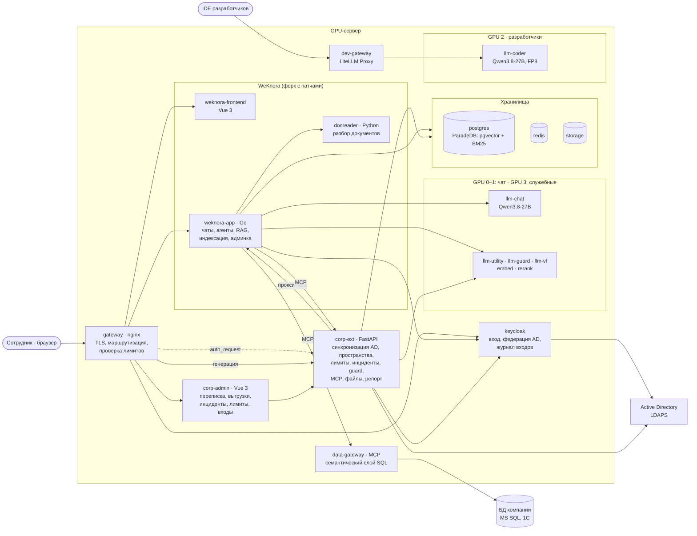
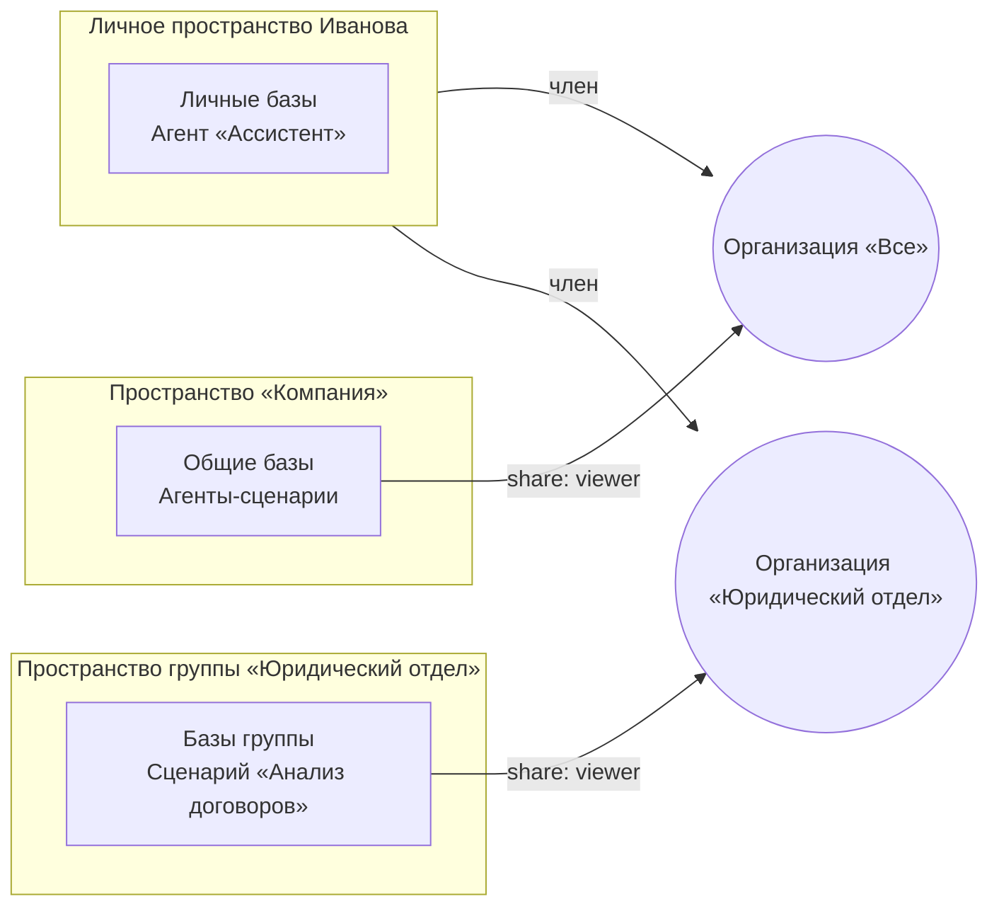
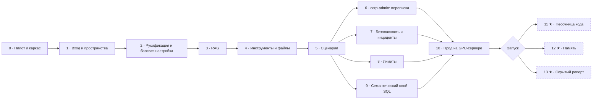

# Корпоративный ИИ-ассистент — ТЗ и план разработки (v2, на базе WeKnora)

Версия от 13.11.2026 · автор: Andrew · v2 — переработка ТЗ от 31.10.2026 под WeKnora 0.9.0

## 0. Как пользоваться документом

Документ — единственный источник требований. Основа системы — открытый проект [WeKnora](https://github.com/Tencent/WeKnora) (MIT); документ описывает, что берём из него как есть, что настраиваем, что дописываем рядом и какие минимальные правки вносим в его код.

- **Людям:** §1–3 — что строим и на каком железе; §6–7 — вход и модель доступа (главное отличие от v1); §8–15 — функции; §21 — этапы и критерии приёмки; §23 — принятые решения и открытые вопросы; Приложение А — реестр правок в коде WeKnora.
- **Агенту:** сначала §22 (правила работы) и §2.4 (как живём с WeKnora), затем §21 (этапы); перед каждым этапом — разделы, на которые он ссылается. Неясное не додумывать: записать вопрос в `docs/status.md`, взять вариант по умолчанию из этого документа, пометить `TODO(question)`.
- Документ лежит в репозитории как `docs/SPEC.md`. Любое изменение требований — правка SPEC и запись в `CHANGELOG.md`.
- Как устроена сама WeKnora — в её документации (`weknora/website-docs/`). Этот документ её не пересказывает, а ссылается на нужные места.

| Метка | Что значит |
| --- | --- |
| MUST | обязательно к запуску |
| SHOULD | желательно к запуску; допустимо перенести в первый релиз после запуска |
| ★ | задача со звёздочкой: делаем после запуска, но точки расширения закладываем сразу |
| FUTURE | не делаем; архитектура не должна мешать добавить позже |
| WK | есть в WeKnora, берём как есть или настраиваем |
| P-NN | правка в коде WeKnora из реестра (Приложение А) |
| CX | делаем в своём сервисе `corp-ext` или `corp-admin` |
| ПИЛОТ | поведение WeKnora нужно подтвердить на пилоте (этап 0) до того, как на него опираться |

«Допущение» — решение по умолчанию, которое нужно подтвердить (§23). Если оно меняется, правится конфигурация или один раздел, а не архитектура.

### 0.1 Что изменилось относительно v1

- Основа — WeKnora 0.9.0 вместо собственного продукта с нуля. Чат, стриминг, RAG, разбор документов, вложения, сценарии (агенты), русский интерфейс уже есть.
- Стек основы — Go + Vue 3 (WeKnora). Свой код — Python 3.12 (`corp-ext`, `data-gateway`) и Vue 3 (`corp-admin`).
- Вход — Keycloak с федерацией AD, в WeKnora — по OIDC. Своего LDAP-провайдера нет.
- Права на базы знаний — через пространства и организации WeKnora (§7), а не через фильтры в Qdrant.
- Группы доступа пока назначаются вручную с массовым импортом списков: отдел из AD не отдаётся. Источник «отдел из AD» реализуется сразу и включается настройкой (§7.3–7.6).
- Векторный и лексический поиск — PostgreSQL + ParadeDB (pgvector + BM25) вместо Qdrant.
- Новый раздел §13 «Язык и русификация».
- Новое Приложение А — реестр правок в коде WeKnora.
- Песочница кода (★) и память (★) в WeKnora уже есть; остаются ★ по срокам включения, а не по объёму разработки.

### 0.2 Ревизия 2.1 от 13.11.2026 — по итогам сверки с кодом WeKnora

Решения 26–32 (§23.1), обоснования — ADR 0008 и 0013–0016.

- Закреплён тег `v0.9.0` (коммит `f17ee8a8`), а не коммит ветки `main` (§1).
- Модерация: guard-модель — первая линия и MUST; скрытый репорт и патч P-04 — после запуска (§10.6).
- Русский BM25-индекс (P-01) ставится шагом `provision --search-index`, а не миграцией в форке (§11.2).
- Запросы на генерацию идут через тонкий прокси `corp-ext`; так точно снимается слот одновременной генерации (§14.3).
- Смена email в AD отслеживается по `objectGUID` и переносится в WeKnora (§7.4).
- Блок-лист IP проверяется в `auth_request`, без файла и перезагрузки nginx (§15.4).
- Фоновые задачи — taskiq вместо Celery (§4).

## 1. Цели, рамки и допущения

Строим в закрытом контуре корпоративного чат-ассистента для 200+ сотрудников и API моделей для агентного кодинга разработчиков — всё на одном сервере с 4× A100.

**Входит в первую версию**

- Веб-чат: вход через AD, история, вложения, режим thinking, стриминг, корпоративные сценарии, лимиты.
- RAG трёх уровней: общие базы, базы групп (отделов), личная база пользователя. Поиск гибридный (BM25 + векторный) с реранкером.
- Инструменты: чтение документов, анализ таблиц, генерация файлов, данные из SQL-БД через семантический слой, скрытый репорт о нарушениях; ★ — выполнение кода в песочнице.
- Админ-панель: пользователи, все чаты и сообщения (включая удалённые), входы, инциденты, лимиты, базы знаний, сценарии, модели, аудит. Часть — в WeKnora, часть — в `corp-admin` (§15).
- Модели для разработчиков: OpenAI-совместимый API с персональными ключами и лимитами.

**Не входит (FUTURE)**: генерация изображений, голос, мобильное приложение, поиск в интернете, разбор картинок во вложениях (кроме OCR сканов, §11.3), кластер из нескольких серверов, внешние облачные LLM, вход через Kerberos, уведомления об инцидентах вне админки, интеграция с service desk. Функции WeKnora из этого списка (поиск в интернете, IM-каналы, браузерный агент, Wiki, граф знаний, внешние источники данных) выключаются конфигурацией (§17.2) и могут быть включены позже без доработок.

**Допущения**

| Параметр | Значение | Статус |
| --- | --- | --- |
| GPU | 4× A100 80 ГБ с NVLink | подтверждено |
| ОС и рантайм | Ubuntu Server (24.04 LTS), Docker Compose, NVIDIA Container Toolkit | подтверждено; версия Ubuntu — допущение |
| Сеть | На старте у сервера есть интернет, позже его отключат. Система с первого дня работает без внешних обращений, обновления — офлайн-бандлом (§18.3) | подтверждено |
| Основа | WeKnora 0.9.0 (тег `v0.9.0`, коммит `f17ee8a8`), закреплена; обновления — по процедуре §18.6 | решение от 13.11.2026 |
| Вход | Логин и пароль домена. Keycloak проверяет их в AD через LDAPS (636) или LDAP + StartTLS; сервисная учётка AD только на чтение. Kerberos не нужен | подтверждено |
| Email в AD | У всех сотрудников заполнен `mail` — WeKnora сопоставляет пользователя по email. Если нет — Keycloak подставляет UPN. Смену email `corp-ext` отслеживает по `objectGUID` и переносит в WeKnora (§7.4) | допущение, проверить при деплое |
| Структура AD | Отдел из AD сейчас получить невозможно, групп по отделам нет. Группы доступа назначаются вручную в `corp-admin` с массовым импортом списков; источник «отдел из AD» заложен в коде и включается настройкой, когда AD начнёт его отдавать (§7.3–7.6). Первые админы задаются в конфиге (§6.3) | подтверждено 13.11.2026 |
| Нагрузка чата | 200–300 пользователей, в пике 10–20 одновременных генераций | допущение |
| Разработчики | 2–3 человека, работают через расширения IDE | подтверждено |
| Базы знаний | 7–10 ГБ документов в общих и отдельских базах на старте, без личных | оценка заказчика |
| Корпоративные БД | MS SQL; телефонный справочник — представление в MS SQL; 1С — возможно позже | подтверждено |
| Язык | Интерфейс, ответы и все генерации — на русском (§13) | подтверждено |
| До приезда сервера | Нет GPU и доступа к AD: разработка на mock-AD (Samba AD DC) и маленькой модели или fake-LLM | — |

## 2. Архитектура

Архитектура — WeKnora как ядро плюс тонкий слой своих сервисов рядом. В код WeKnora вносим только правки из реестра (Приложение А); всё, что можно сделать через её API, конфигурацию, встроенные MCP-сервисы или прокси, делаем снаружи.



Сотрудник проходит через nginx: интерфейс и API чата обслуживает WeKnora, вход — Keycloak. Запросы на генерацию идут в WeKnora через тонкий прокси `corp-ext`, который проверяет лимиты; остальные запросы nginx сверяет с `corp-ext` подзапросом `auth_request` (блокировки, блок-лист IP, лимит загрузок). WeKnora вызывает свои модели на GPU 0–1 и 3, а корпоративные инструменты — по MCP у `corp-ext` и `data-gateway`. `corp-ext` синхронизирует AD с пространствами WeKnora и читает её БД только на чтение для админки, лимитов и модерации. Разработчики попадают к своей модели на GPU 2 только через `dev-gateway`.

### 2.1 Компоненты

| Компонент | Назначение | Технология | Источник |
| --- | --- | --- | --- |
| `gateway` | TLS, маршрутизация, лимит размера загрузок, SSE без буферизации, чат-эндпоинты — через прокси `corp-ext`, `auth_request` (блокировки, блок-лист IP, лимит загрузок) | nginx | свой конфиг |
| `keycloak` | Форма входа, проверка пароля в AD, атрибуты AD, защита от перебора, журнал входов, OIDC для WeKnora | Keycloak + PostgreSQL (отдельная БД в общем postgres) | конфиг realm в репозитории |
| `weknora-frontend` | SPA пользователя и админки WeKnora | Vue 3 + TypeScript + TDesign | WK + P-05…P-07 |
| `weknora-app` | Чаты, агенты (сценарии), RAG, индексация, модели, MCP-клиент, админка WeKnora | Go 1.26, Gin, GORM, asynq | WK + P-02, P-03 (★ P-04) |
| `docreader` | Разбор документов в Markdown | Python, gRPC | WK |
| `corp-ext` | Синхронизация с AD и раскладка по пространствам (§7), профиль, лимиты и прокси чат-эндпоинтов (§14.3), инциденты, guard-модерация, выгрузки, лайки и папки, API для `corp-admin`; встроенные MCP-сервисы `corp-files` и `corp-report` | Python 3.12, FastAPI, taskiq | CX |
| `corp-admin` | Разделы админки, которых нет в WeKnora (§15) | Vue 3 + TypeScript + TDesign | CX |
| `data-gateway` | Семантический слой над SQL-БД: каталог, функции, контролируемый text-to-SQL; встроенный MCP-сервис | Python 3.12, FastAPI, MCP SDK, SQLAlchemy, sqlglot | CX |
| `sandbox` ★ | Выполнение кода в песочнице | Docker-бэкенд WeKnora с рантаймом gVisor (`runsc`) | WK |
| `postgres` | БД WeKnora, схема `corp`, БД Keycloak; векторный и BM25-поиск | ParadeDB (PostgreSQL + pgvector + pg_search) — образ из compose WeKnora | WK |
| `redis` | Очереди и потоки WeKnora; счётчики лимитов и брокер `corp-ext` (отдельный номер БД) | Redis 7 | WK |
| `storage` | Загрузки, документы, сгенерированные файлы | Локальный том (бэкенд `local` WeKnora); MinIO — FUTURE | WK |
| `llm-chat`, `llm-coder`, `llm-utility`, `llm-guard`, `llm-vl`, `embed`, `rerank` | Инференс моделей | vLLM, OpenAI-совместимый API | свой compose |
| `dev-gateway` | Ключи, лимиты и учёт запросов разработчиков | LiteLLM Proxy | свой конфиг |
| `monitoring` | Метрики и дашборды, включая GPU | Prometheus, Grafana, DCGM exporter | свой конфиг |
| `langfuse` (SHOULD) | Трассировка шагов агента, поиска и токенов | Langfuse из compose-профиля WeKnora | WK |

### 2.2 Как проходит одно сообщение

1. Браузер отправляет `POST /api/v1/agent-chat/{session_id}` (или `/knowledge-chat/...` для быстрых ответов) с JWT WeKnora.
2. nginx направляет этот запрос в прокси `corp-ext`: тот проверяет подпись JWT, блокировку пользователя и лимиты, резервирует слот одновременной генерации и передаёт запрос в `weknora-app`, пропуская поток ответа без буферизации. Отказ — HTTP 429 с телом `{metric, limit, used, reset_at}` (§14.3). По завершении запроса слот снимается.
3. WeKnora собирает промпт агента, при необходимости переформулирует запрос, ищет по доступным базам знаний (§11), вызывает модель со стримингом и ведёт цикл инструментов. Корпоративные инструменты вызываются по MCP у `corp-ext` и `data-gateway` с подписанным заголовком пользователя (P-03).
4. Ответ, шаги агента, источники и расход токенов (`messages.usage`) сохраняются в Postgres WeKnora; браузер получает поток по SSE WeKnora. «Стоп» — `POST /api/v1/sessions/{session_id}/stop`.
5. `corp-ext` раз в 15–30 секунд забирает новые сообщения: списывает токены в лимиты, снимает слоты генераций, которые продолжились после обрыва соединения, отправляет сообщение пользователя на проверку guard-модели (§10.6), пишет инциденты.

Протокол SSE — внутренний контракт WeKnora, мы его не меняем. К запуску правок в этом месте нет; скрытие вызовов скрытых MCP-сервисов (P-04) — после запуска (§10.6).

### 2.3 Ключевые решения (оформить как ADR)

| № | Решение | Почему | Отвергнутая альтернатива |
| --- | --- | --- | --- |
| 1 | Основа — WeKnora (MIT) | Чат, агенты, RAG с гибридным поиском и реранкером, разбор документов, вложения, русский интерфейс, песочница и память уже есть и развиваются. Писать это с нуля — основная часть объёма v1 | Собственный продукт (v1 ТЗ) — слишком долго; форк Open WebUI — с v0.6.6 брендинг нельзя менять без enterprise-лицензии при более чем 50 пользователях; LibreChat (MIT) — нет уровней RAG, тот же глубокий форк |
| 2 | WeKnora без глубокого форка: закреплённая версия + короткий реестр патчей + свои сервисы рядом | WeKnora выходит каждые 2–3 недели, до 1.0 и с несовместимыми изменениями. Глубокий форк быстро перестанет обновляться | Свободные правки в коде WeKnora |
| 3 | Вход — Keycloak с федерацией AD, в WeKnora — OIDC | В WeKnora нет LDAP. Keycloak даёт форму входа, атрибуты AD, блокировку при переборе, журнал входов и отзыв сессий без кода; позже — Kerberos | LDAP-провайдер патчем в Go — большой постоянный патч; Dex — нет блокировки и журнала событий |
| 4 | Права на базы — через пространства и организации WeKnora (§7) | Работает на штатных механизмах; агент с `kb_selection_mode: all` ищет одним запросом по своим и расшаренным базам | Патч прав на уровне отдельных баз внутри одного пространства — глубокая правка RBAC ядра |
| 5 | Поиск — PostgreSQL + ParadeDB, а не Qdrant | Драйвер Qdrant в WeKnora не считает BM25 (только совпадение токенов), а ParadeDB даёт настоящий BM25 со стеммером для русского | Qdrant — пришлось бы переписывать драйвер |
| 6 | Свой код — Python (`corp-ext`, `data-gateway`), своя админка — Vue 3 + TDesign | Python — основной язык команды; Vue и TDesign — те же, что у WeKnora, поэтому один фронтенд-стек и единый вид | React для `corp-admin` — второй фронтенд-стек |
| 7 | Корпоративные инструменты — встроенные MCP-сервисы WeKnora (`is_builtin`) | Видны во всех пространствах без настройки каждого; код вне ядра | Инструменты в Go внутри WeKnora |
| 8 | Лимиты — прокси чат-эндпоинтов в `corp-ext` и `auth_request` в nginx + учёт по `messages.usage` | Ни одной правки в ядре; прокси знает момент завершения запроса и вовремя снимает слот генерации | Патч лимитов в Go; только `auth_request` — слот снимался бы опросом с задержкой и давал ложные отказы |
| 9 | Генерация файлов к запуску — MCP-инструменты `corp-files` (pandoc, python-docx, openpyxl, python-pptx), песочница — ★ | Не нужна песочница с Docker-сокетом в каждом личном пространстве; корпоративные шаблоны как в v1 | Навыки в песочнице WeKnora для всех — тяжелее в эксплуатации и безопасности |
| 10 | vLLM для всех моделей | OpenAI-совместимый API, tool calling, парсеры reasoning, prefix caching, метрики | Ollama — слабее под параллельной нагрузкой |
| 11 | LiteLLM Proxy только для разработчиков | Виртуальные ключи, лимиты и учёт без своей разработки | Свой шлюз |
| 12 | JWT WeKnora в localStorage — принятое отступление | Так устроена WeKnora; переделка на cookie — глубокий патч. Риск XSS снижаем строгой CSP и санитизацией | Патч на cookie-сессии |
| 13 | Модерация: guard-модель — первая линия; скрытый репорт (P-04) — после запуска | Сотрудник (Contributor) может прочитать промпт агента и создать своего агента без политики и без `corp-report`; guard проверяет сообщения независимо от агента | Скрытый репорт как основная линия — обходится; P-04 к запуску — самый дорогой патч ради обходимого механизма |
| 14 | Русский BM25-индекс — шагом `provision --search-index`, а не миграцией в форке | Нумерация миграций WeKnora сквозная: наш номер совпал бы с будущим апстримным, и та миграция была бы молча пропущена | Миграция в `migrations/versioned/` форка |
| 15 | Фоновые задачи — taskiq | Код `corp-ext` асинхронный; Celery синхронный и потребовал бы второй, синхронный доступ к БД | Celery + celery beat; собственный воркер на таблицах `corp` — запасной вариант |
| 16 | Сотрудник опознаётся по `objectGUID`; смена email переносится в WeKnora | WeKnora ищет пользователя по email и при промахе создаёт нового — смена `mail` в AD дала бы пустую учётку-дубликат | Только email как ключ; синтетический email из GUID — некрасиво в интерфейсе |

### 2.4 Как живём с WeKnora

- **Форк.** Свой форк `weknora` во внутреннем git; рабочая ветка `corp/v<версия>` (сейчас `corp/v0.9.0`) = тег WeKnora + наши коммиты. В основном репозитории он подключён подмодулем `weknora/`.
- **Патчи.** Каждая правка — отдельный коммит с префиксом `P-NN:` и записью в Приложении А: зачем, какие файлы, как проверить, статус пулл-реквеста в WeKnora. Правки, полезные всем (русские тексты, настраиваемый токенизатор, плейсхолдеры профиля), отправляем в WeKnora пулл-реквестом, чтобы реестр сокращался.
- **Порядок выбора.** Сначала конфигурация и API WeKnora → потом встроенный MCP-сервис или прокси в nginx → потом свой сервис рядом → и только затем патч. Новый патч согласуется в ADR.
- **Своя схема БД.** `corp-ext` пишет только в схему `corp`. Таблицы WeKnora читает под отдельной ролью с правом `SELECT`; изменения в данных WeKnora — только через её API. Исключения перечислены в §16.2.
- **Обновления.** Не каждый релиз: раз в квартал или по исправлению безопасности, по runbook §18.6.

## 3. Сервер и распределение GPU

Решение: GPU 0–1 — чату, GPU 2 — разработчикам, GPU 3 — служебным моделям и резерву. Разработчиков 2–3, поэтому одной A100 им хватает с запасом, а освободившаяся карта снимает служебные модели с чата и даёт место модели для OCR сканов.

### 3.1 Что важно знать про A100

- FP8 на Ampere работает только как weight-only W8A16 через Marlin: экономит память, но не ускоряет вычисления, как на H100 ([vLLM](https://docs.vllm.ai/en/v0.13.0/features/quantization/fp8/)). INT4 (AWQ/GPTQ) через Marlin — способ уместить модели крупнее.
- Генерация упирается в пропускную способность памяти, поэтому меньшая разрядность весов ускоряет вывод токенов, особенно у плотных моделей.
- NVLink проверить командой `nvidia-smi topo -m`. Tensor parallel = 2 — внутри пары с NVLink; TP = 4 без полного NVLink не делать.
- MIG делит A100 на изолированные части, но такие GPU не участвуют в tensor parallel. В базовой схеме MIG не используем; для GPU 3 он — опция (3.2).
- Предпочтительны модели с гибридным вниманием (Gated DeltaNet + attention, как у Qwen3.5 и новее): KV-кэш в разы меньше, поэтому длинные договоры и контексты агентов дешевле по памяти.
- В WeKnora модели описываются в `config/builtin_models.yaml` и видны во всех пространствах (§9.1). Смена модели — правка этого файла и compose, без правок кода.

### 3.2 Распределение для 4× A100 80 ГБ

```text
GPU 0  │████████████████████████████████████░░┊░░│  llm-chat 0,90 (TP = 2 вместе с GPU 1)
GPU 1  │████████████████████████████████████░░┊░░│  llm-chat 0,90
GPU 2  │██████████████████████████████████▓▓▓░┊░░│  llm-coder 0,85 │ llm-fim (опц.) 0,08
GPU 3  │█████▓▓▓▓▓████▓▓▓▓██████░░░░░░░░░░░░░░┊░░│  embed + rerank 0,12 │ llm-utility 0,12 │ llm-guard 0,10 │ llm-vl 0,15 │ резерв ~0,46

1 символ = 2 ГБ (2,5 %) · █▓ — сервисы слева направо · ░ — свободно · ┊ — предел 95 %
```

У чата две GPU целиком и без соседей; 2–3 разработчикам хватает одной карты. Почти половина GPU 3 остаётся резервом под эксперименты, рост нагрузки и разбор сканов при массовом импорте.

| GPU | Сервис | Модель по умолчанию | Доля памяти GPU |
| --- | --- | --- | --- |
| 0 + 1 (TP = 2) | `llm-chat` | Qwen3.8-27B, BF16 (~56 ГБ весов) | 0,90 |
| 2 | `llm-coder` | Qwen3.8-27B, FP8 (~28 ГБ весов) | 0,85 |
| 2 (опционально) | `llm-fim` | малая кодовая модель с FIM для автодополнения в IDE | 0,08 |
| 3 | `embed`, `rerank` | bge-m3, bge-reranker-v2-m3 | 0,12 |
| 3 | `llm-utility` | Qwen3.5-4B, FP8 | 0,12 |
| 3 | `llm-guard` | Qwen3Guard-Gen-4B | 0,10 |
| 3 | `llm-vl` | малая визуально-языковая модель для OCR сканов (§11.3); не нужна, если `llm-chat` принимает изображения | 0,15 |
| 3 | резерв | эксперименты разработчиков, рост нагрузки, MinerU при массовом импорте (опц.) | ~0,46 |

Оценка по архитектуре из карточки модели: у чата под KV-кэш остаётся около 80 ГБ — порядка 1,2 млн токенов, это десятки одновременных диалогов с длинными документами. У кодинга — около 40 ГБ, порядка 0,6 млн токенов: на 2–3 разработчиков хватит одной-двух параллельных агентных сессий по 100 тыс. токенов у каждого. Цифры проверить нагрузочным тестом (`vllm bench serve`) в первый день на сервере.

- Сумма долей памяти на одной GPU — не больше 0,95. Порядок запуска контейнеров фиксирован через `depends_on`: сначала крупная модель, затем мелкие.
- Для чата включить prefix caching и, если стабильно работает в выбранной версии vLLM, MTP-спекулятивное декодирование — оно ускоряет генерацию.
- BF16 для чата — без потерь качества. FP8 (W8A16) — если понадобится скорость генерации или больше памяти под KV; решать по бенчмарку.

Стартовые команды запуска (финальные флаги — по рецепту vLLM для выбранной версии):

```bash
# llm-chat, GPU 0–1
CUDA_VISIBLE_DEVICES=0,1 vllm serve Qwen/Qwen3.8-27B \
  --tensor-parallel-size 2 --gpu-memory-utilization 0.90 --max-model-len 131072 \
  --reasoning-parser qwen3 --enable-auto-tool-choice --tool-call-parser qwen3_coder

# llm-coder, GPU 2
CUDA_VISIBLE_DEVICES=2 vllm serve Qwen/Qwen3.8-27B-FP8 \
  --gpu-memory-utilization 0.85 --max-model-len 262144 \
  --reasoning-parser qwen3 --enable-auto-tool-choice --tool-call-parser qwen3_coder
```

Для кодинга по умолчанию та же модель, что для чата, но в FP8 на одной карте: одно семейство моделей, одни парсеры и настройки. Альтернатива для сравнения в первую неделю — Qwen3-Coder-Next в AWQ 4 бита (~45 ГБ на одной карте): она быстрее за счёт 3B активных параметров. Если разработчики будут запускать на резерве GPU 3 свои эксперименты, на этой карте включается MIG (например, 3g.40gb под служебные модели и 4g.40gb под эксперименты). Тогда эксперимент не сможет вытеснить служебные модели из памяти.

### 3.3 Кандидаты моделей

Список актуален на 31.10.2026. Финальный выбор — после бенчмарка на 30–50 своих запросах: русский язык, документы, вызов инструментов.

| Роль | Модель по умолчанию | Размер и лицензия | Почему она | Альтернативы для сравнения |
| --- | --- | --- | --- | --- |
| Чат | [Qwen3.8-27B](https://huggingface.co/Qwen/Qwen3.8-27B) | 27B, плотная; Apache 2.0; контекст 262K | Thinking включается и выключается на каждый запрос, есть `reasoning_effort`; сильна в офисных задачах и коде; гибридное внимание | Qwen3.5-122B-A10B в INT4 — больше знаний; [Gemma 4 31B](<https://en.wikipedia.org/wiki/Gemma_(language_model)>), Apache 2.0 |
| Кодинг | Qwen3.8-27B в официальной FP8-версии | 27B; Apache 2.0; 262K | Сильные результаты в агентном кодинге по карточке модели; та же модель, что у чата; помещается на одну GPU | [Qwen3-Coder-Next](https://dell.huggingface.co/models/Qwen/Qwen3-Coder-Next) в AWQ 4 бита — 80B, из них 3B активных, быстрее; Qwen3.6-35B-A3B |
| Служебная | Qwen3.5-4B, FP8 | 4B; Apache 2.0 | Заголовки, переформулировка запросов, генерация вопросов и кратких содержаний при индексации — быстро и дёшево | [GigaChat 3.1 Lightning](https://en.immers.cloud/ai/sber-ai/gigachat3.1-10b-a1.8b/) — 10B, из них 1,8B активных; MIT; сильный русский |
| Модерация | [Qwen3Guard-Gen-4B](https://sotaverified.org/papers/251014276) | 0,6B / 4B / 8B; Apache 2.0; 119 языков | Метки safe, controversial, unsafe и категории нарушений | 0,6B — если не хватает памяти |
| OCR сканов | малая VL-модель, выбрать на пилоте | — | Сканы PDF WeKnora распознаёт визуально-языковой моделью (§11.3) | MinerU как внешний движок разбора |
| Эмбеддинги | BAAI/bge-m3 | 568M; 1024 измерения; 8192 токена | Лучший retrieval среди не-instruct моделей на русском бенчмарке ruMTEB ([статья](https://arxiv.org/html/2408.12503v1)); у pgvector в WeKnora есть HNSW-индекс для 1024 измерений | Qwen3-Embedding-0.6B / 4B — сравнить на своих документах |
| Реранкер | BAAI/bge-reranker-v2-m3 | ~0,6B | Мультиязычный cross-encoder; vLLM отдаёт `/rerank` в формате Cohere, который WeKnora понимает | Qwen3-Reranker-0.6B / 4B |

Критерии для любой замены: деловой русский язык; надёжный tool calling через парсер vLLM; управление thinking на запрос (для чата); контекст не меньше 64K для чата и 128K для кодинга; лицензия, разрешающая коммерческое использование; работа на A100 в BF16, FP8 W8A16 или INT4; модель проходит проверку в каталоге WeKnora (`runtime.ValidateRow`).

### 3.4 Доступ разработчиков

Не зависит от WeKnora и не меняется относительно v1.

- Разработчиков 2–3, работают через расширения IDE: Continue, Cline, Roo Code, Kilo Code — все умеют OpenAI-совместимый API. Готовые конфиги — в `docs/guides/dev-coding-setup.md`.
- Отдельный шлюз `dev-gateway` (LiteLLM Proxy) по HTTPS, доступ только из подсетей разработчиков.
- Персональный ключ на каждого: лимиты RPM и TPM, число параллельных запросов, дневной бюджет токенов, журнал запросов.
- Модели в шлюзе: `coder` — с размышлениями, для агентного режима; `coder-fast` — тот же бэкенд без размышлений, для быстрых правок (шлюз сам подставляет `chat_template_kwargs`; проверить на выбранной версии LiteLLM); `fim` — автодополнение, опционально; `embed` — для индексации кода в расширениях.
- Модель разработчиков живёт в отдельном compose-проекте `deploy/models/coder/` и закреплена за GPU 2 через `CUDA_VISIBLE_DEVICES`. Смена модели — по runbook, без влияния на чат. Эксперименты — на резерве GPU 3 по согласованию.
- Дополнительно разработчики могут подключать базы знаний WeKnora в IDE через её встроенный MCP Server (`/mcp/<endpoint_id>`) — SHOULD, после запуска.

### 3.5 Если мощности не хватает

1. Включить CPU-offload KV-кэша (LMCache или встроенный в vLLM): 2 ТБ ОЗУ позволяют держать сотни гигабайт кэша префиксов для длинных сессий агентов.
2. Если разработчиков станет больше — отдать им резерв GPU 3 под вторую копию `llm-coder`.
3. Если вырастет нагрузка на чат — сначала поднять `max_num_seqs` и проверить очередь, затем перевести чат на FP8 и отдать освободившуюся память под KV-кэш. Ограничение одновременных вызовов модели со стороны WeKnora — `model.max_concurrency` (по умолчанию 32).
4. Крайний вариант — одна большая модель на все 4 GPU (например, Qwen3.5-397B-A17B в INT4). Это максимум качества, но чат и разработчики делят GPU, а вспомогательным моделям почти не остаётся места. Рассматривать, только если 27B не устроит по итогам пилота.

### 3.6 CPU и 2 ТБ ОЗУ

- Postgres с pgvector и BM25-индексом (индексы держатся в памяти), Redis, Keycloak.
- `docreader` и воркеры индексации WeKnora: нагружают CPU; параллелизм пулов задаётся в системных настройках WeKnora (`asynq.*_concurrency`) и переменных `DOCREADER_*`.
- ★ Песочницы выполнения кода.
- CPU-offload KV-кэша vLLM (см. 3.5).
- FUTURE, эксперимент: очень большие MoE-модели с экспертами в ОЗУ через llama.cpp или KTransformers. Скорость низкая, подходит только для редких тяжёлых задач.

## 4. Технологический стек

Стек основы задан WeKnora; свой код пишем на Python и Vue. Новая зависимость появляется только с обоснованием в ADR или описании PR.

**Основа — WeKnora 0.9.0** (меняем только патчами из Приложения А)

- Бэкенд: Go 1.26, Gin, GORM, миграции в `migrations/versioned/` (применяются автоматически при старте), asynq поверх Redis.
- Фронтенд: Vue 3 + TypeScript + Vite, TDesign, Pinia, vue-i18n, marked + KaTeX, Mermaid, pdf.js.
- Разбор документов: `docreader` (Python, gRPC): pdfium, MarkItDown, anydoc для Office, OpenDataLoader; OCR сканов — визуально-языковой моделью; внешний MinerU — опция.
- Поиск: PostgreSQL (ParadeDB) — pgvector (HNSW) и pg_search (BM25), слияние RRF в WeKnora; реранкер — внешний `/rerank`.
- Трассировка: Langfuse (опционально).

**Свой код** (`corp-ext`, `data-gateway`)

- Python 3.12, зависимости через `uv` (lock-файл `uv.lock`).
- FastAPI, Pydantic v2, pydantic-settings — конфиг валидируется при старте.
- SQLAlchemy 2 (async) + asyncpg, миграции Alembic — только для схемы `corp`. Redis 7 через redis-py (asyncio).
- Фоновые задачи: taskiq с брокером Redis (`taskiq-redis`), расписания — планировщик taskiq. Очередь асинхронная, как и остальной код (ADR 15).
- MCP-серверы: официальный Python SDK `mcp` (транспорт Streamable HTTP).
- LLM (guard, служебная): официальный SDK `openai` (AsyncOpenAI) к эндпоинтам vLLM.
- AD: `ldap3` (синхронизация атрибутов и фото, диагностика). Keycloak: его Admin REST API.
- Генерация файлов: pandoc — Markdown → DOCX по шаблону, формулы LaTeX становятся формулами Word; python-docx, openpyxl, python-pptx; LibreOffice headless — DOCX → PDF.
- SQL-слой: SQLAlchemy Core + pyodbc с Microsoft ODBC Driver 18 для MS SQL; sqlglot (диалект T-SQL) для разбора и проверки SQL.
- Логи: structlog (JSON в stdout); метрики: prometheus-client.
- Качество: ruff, mypy, pytest, pytest-asyncio, testcontainers, respx.

**Свой фронтенд** (`corp-admin`, патчи во фронтенде WeKnora)

- Vue 3 + TypeScript (strict) + Vite, TDesign — как у WeKnora; пакеты через pnpm.
- API-клиент и типы генерируются из OpenAPI `corp-ext` (`openapi-typescript` + `openapi-fetch`).
- Таблицы — TDesign Table с виртуализацией; графики — ECharts.
- i18n — vue-i18n, русский по умолчанию.
- Тесты: Vitest, Playwright для e2e (общий набор e2e для WeKnora и `corp-admin`).

**Инфраструктура**: Docker Compose (профили `dev` и `prod`), nginx, ParadeDB, Redis 7, Keycloak, vLLM, LiteLLM Proxy, Prometheus, Grafana, DCGM exporter, gVisor (`runsc`) для песочницы (★).

**Правила**

- Версии всех зависимостей закреплены lock-файлами, образы — по digest; образы WeKnora собираются из своего форка.
- Никаких сетевых обращений наружу в рантайме: телеметрия отключена, модели, шрифты, KaTeX и прочее — только локально. В WeKnora включается режим исходящих запросов только по белому списку (§17.2).

## 5. Структура репозитория и карта изменений

Монорепозиторий: свой код, конфигурация, развёртывание и документация лежат вместе, WeKnora — подмодулем. Карта изменений ниже (копия — в `AGENTS.md`) за минуту отвечает на вопрос «где править».

```text
ai-assistant/
├── AGENTS.md                 # правила и карта проекта для людей и ИИ-агентов
├── CLAUDE.md                 # одна строка: @AGENTS.md
├── README.md                 # быстрый старт
├── CHANGELOG.md
├── Makefile                  # dev-up, check, test, lint, e2e, gen-api, deploy, docs-check, weknora-build
├── docs/
│   ├── SPEC.md               # этот документ
│   ├── status.md             # прогресс этапов и открытые вопросы
│   ├── patches.md            # реестр патчей WeKnora (копия Приложения А, рабочая версия)
│   ├── architecture/         # overview, request-flow, access-model, data-model, security
│   ├── adr/                  # 0001-weknora-base.md, 0002-keycloak.md, ...
│   ├── guides/               # add-mcp-tool, add-scenario, add-model, add-corp-admin-page,
│   │                         # add-limit-metric, ad-setup, keycloak-setup, dev-coding-setup,
│   │                         # deploy, offline-bundle, write-weknora-patch
│   ├── reference/            # config.md, corp-api.md (генерируется), permissions.md, db-schema-corp.md
│   └── runbooks/             # models.md, backup-restore.md, incidents.md, rotate-secrets.md,
│                             # weknora-upgrade.md
├── weknora/                  # подмодуль: форк WeKnora, ветка corp/v0.9.0 (§2.4)
├── services/
│   ├── corp-ext/
│   │   ├── pyproject.toml
│   │   ├── app/
│   │   │   ├── main.py
│   │   │   ├── core/         # config, logging, db, redis, security (проверка JWT WeKnora), errors
│   │   │   ├── modules/      # бизнес-модули, у каждого свой README.md
│   │   │   │   ├── adsync/       # синхронизация AD → профили; источники ad_department, ad_group
│   │   │   │   ├── groups/       # группы, членство и его источники, импорт и выгрузка списков
│   │   │   │   ├── provisioning/ # пространства, организации, членство, агенты по умолчанию (§7)
│   │   │   │   ├── weknora/      # клиент API WeKnora и read-only доступ к её таблицам
│   │   │   │   ├── keycloak/     # клиент Admin API, события входа
│   │   │   │   ├── profile/      # профиль, форма обращения, уведомление при первом входе
│   │   │   │   ├── limits/       # политики, счётчики, auth_request
│   │   │   │   ├── chats/        # чтение переписки для админки, папки, лайки
│   │   │   │   ├── moderation/   # guard-модель, политика
│   │   │   │   ├── incidents/    # ошибки, репорты, захват логов
│   │   │   │   ├── security/     # журнал входов, правила, блокировки
│   │   │   │   ├── exports/      # выгрузки
│   │   │   │   ├── audit/        # журнал действий админов corp-admin
│   │   │   │   └── mcp/          # встроенные MCP-сервисы corp-files и corp-report
│   │   │   ├── workers/      # брокер taskiq, задачи, расписания
│   │   │   └── cli/          # ad check, provision, create-admin, purge
│   │   ├── migrations/       # Alembic, только схема corp
│   │   └── tests/
│   ├── corp-admin/           # Vue 3 SPA админки: src/pages/*, src/components/*, tests/
│   ├── data-gateway/         # семантический слой SQL + catalog/*.yaml
│   └── fake-llm/             # OpenAI-совместимый mock для тестов
├── config/
│   ├── weknora/              # .env.weknora, builtin_models.yaml, переопределения prompt_templates
│   ├── keycloak/             # realm-export.json (без секретов), тема входа
│   ├── scenarios/            # сценарии как описания агентов WeKnora (seed, §9.3)
│   ├── moderation/policy.yaml
│   ├── limits/policies.yaml
│   └── templates/            # reference.docx, presentation.pptx для corp-files
├── deploy/
│   ├── compose/              # docker-compose.yml (включает compose WeKnora), compose.dev.yml, .env.example
│   ├── nginx/
│   ├── models/               # chat/, coder/, aux/ — compose-проекты vLLM; litellm/config.yaml
│   ├── monitoring/
│   ├── mock-ad/              # Samba AD DC + seed тестовых пользователей
│   └── offline/              # сборка офлайн-бандла
└── eval/                     # rag/questions.yaml, scenarios/*, language/*, скрипты оценки
```

**Карта изменений**

| Хочу… | Где править | Что обновить вместе с этим |
| --- | --- | --- |
| Изменить вид сообщения, кнопки под ним | `weknora/frontend/src/views/chat/` — это патч | Приложение А, e2e-тест |
| Добавить корпоративный инструмент для модели | `services/corp-ext/app/modules/mcp/` или `services/data-gateway/` | `docs/guides/add-mcp-tool.md`, тест на fake-LLM |
| Добавить сценарий | админка WeKnora (агент) + `config/scenarios/*.yaml` для seed | промпт сценария, расшаривание в организации (§9.3) |
| Сменить или добавить модель | `config/weknora/builtin_models.yaml` + `deploy/models/` | `docs/runbooks/models.md` |
| Изменить системный промпт | промпт агента в админке WeKnora или `config/weknora/prompt_templates/` | прогон `eval/scenarios` и `eval/language` |
| Добавить поле профиля из AD | маппер в Keycloak/`adsync` + `modules/profile/` + миграция `corp` | `docs/guides/ad-setup.md`; если поле нужно в промпте — P-02 |
| Добавить страницу админки | `services/corp-admin/src/pages/` + `corp-ext/app/modules/<модуль>/` | новое право в `docs/reference/permissions.md` |
| Добавить метрику лимитов | `services/corp-ext/app/modules/limits/` | `config/limits/policies.yaml`, `docs/reference/config.md` |
| Добавить тип инцидента | `services/corp-ext/app/modules/incidents/` | фильтры в `corp-admin` |
| Добавить набор данных или функцию SQL | `services/data-gateway/catalog/` | описания полей и примеры запросов |
| Поменять правила раскладки по пространствам | `services/corp-ext/app/modules/provisioning/` | `docs/architecture/access-model.md`, тесты изоляции |
| Добавить источник членства в группах (например, из 1С или кадровой системы) | `services/corp-ext/app/modules/groups/sources/` | `docs/guides/add-group-source.md`, тест пробного прогона |
| Изменить код WeKnora | только по `docs/guides/write-weknora-patch.md` | Приложение А и `docs/patches.md`, тест патча |
| Изменить схему `corp` | модель SQLAlchemy + миграция Alembic | `docs/reference/db-schema-corp.md` (генерируется) |

## 6. Аутентификация через AD и профиль

Пользователь вводит доменный логин и пароль на странице Keycloak; Keycloak проверяет их в AD и выдаёт WeKnora OIDC-токен. WeKnora сопоставляет пользователя по email и выпускает свой JWT. Всё, что зависит от конкретного AD, вынесено в конфиг Keycloak и `corp-ext` и проверяется командой `ad check` в день деплоя.

### 6.1 Поток входа

1. Пользователь открывает портал; WeKnora показывает кнопку входа через OIDC. SHOULD: сразу перенаправлять на `/api/v1/auth/oidc/start`, чтобы не было лишнего экрана.
2. Keycloak показывает форму входа (тема на русском, логотип компании). Логин `ivanov`, `ivanov@corp.local` и `CORP\ivanov` приводятся к sAMAccountName (маппер или SPI-нормализация; ПИЛОТ — проверить, какие формы Keycloak принимает штатно).
3. Keycloak проверяет пароль bind-ом в AD через федерацию LDAP (режим `READ_ONLY`, LDAPS, импорт пользователей включён), проверяет, что учётка включена, и при заданной `access_group` — членство в ней.
4. Защита от перебора — штатная в Keycloak (§6.3): пороги ниже политики блокировки AD.
5. Keycloak возвращает WeKnora код авторизации; WeKnora проверяет `id_token` по JWKS, находит пользователя по email и выдаёт пару JWT (access 24 ч, refresh 7 дней).
6. Если пользователя в WeKnora ещё нет, его заранее создаёт `corp-ext` при синхронизации (§7.4). WeKnora при входе по OIDC сама создаёт пользователя, если не нашла его по email (`provisionOIDCUser`); после смены email в AD это дало бы пустую учётку-дубликат. ПИЛОТ: отключить автосоздание, чтобы вход до синхронизации давал ошибку, а не дубликат. Если не отключается — автосоздание остаётся запасным путём (режим `auth.default_tenant_mode = tenantless`, пространство `corp-ext` достроит при ближайшей синхронизации), а дубликаты после смены email `corp-ext` находит и показывает в `corp-admin` (§7.4).
7. Пользователь при любой ошибке видит одно сообщение: «Неверный логин или пароль». Точная причина — в событиях Keycloak и журнале входов `corp-admin`.

Пустой пароль Keycloak отклоняет до обращения к AD; значения в LDAP-фильтрах экранирует сам Keycloak. Оба случая покрываются тестами (§20.2).

### 6.2 Провайдеры

- `keycloak-ldap` (MUST): форма Keycloak + федерация AD.
- Парольный вход WeKnora и регистрация: выключены (`auth.registration_mode = invite_only`). Локальные пароли WeKnora остаются только у служебной учётки `svc-provisioner`.
- `dev` (только разработка): Keycloak с mock-AD (Samba AD DC) и seed-пользователями.
- `kerberos` (FUTURE): Keycloak умеет SPNEGO; добавляется настройкой realm и keytab без изменений в WeKnora.

### 6.3 Конфигурация

Realm Keycloak хранится экспортом в `config/keycloak/realm-export.json` (без секретов) и применяется при развёртывании.

```yaml
# Ключевые настройки realm (суть, а не формат файла)
realm: corp
login_theme: corp-ru                  # русская тема входа
brute_force_protection:
  enabled: true
  failure_factor: 5                   # неудачных попыток по логину
  wait_increment_seconds: 900         # временная блокировка 15 минут
  max_failure_wait_seconds: 900
  permanent_lockout: false
events:
  enabled: true                       # LOGIN, LOGIN_ERROR, LOGOUT
  expiration_days: 400                # не меньше срока хранения переписки (уточнить у ИБ)
sessions:
  sso_session_idle: 8h
  sso_session_max: 7d
user_federation:
  ldap:
    connection_url: "ldaps://dc1.corp.local:636 ldaps://dc2.corp.local:636"
    bind_dn: "CN=svc-ai-assistant,OU=Service Accounts,DC=corp,DC=local"
    bind_credential: "${vault.ldap_bind_password}"
    users_dn: "DC=corp,DC=local"
    username_attribute: sAMAccountName
    uuid_attribute: objectGUID
    custom_user_filter: "(&(objectCategory=person)(objectClass=user))"
    edit_mode: READ_ONLY
    trust_email: true
    mappers:                          # атрибуты AD → атрибуты Keycloak → claims
      email: mail                     # если mail пуст — userPrincipalName (допущение §1)
      first_name: givenName
      last_name: sn
clients:
  weknora:
    protocol: openid-connect
    redirect_uris: ["https://ai.corp.local/api/v1/auth/oidc/callback"]
    scopes: [openid, email, profile]
```

```yaml
# config/corp-ext.yaml — то, что Keycloak не делает
auth:
  bootstrap_admins: [ivanov]          # логины первых админов; остальные роли — в corp-admin
  access_group: ""                    # пусто — пускать всех включённых пользователей домена
  per_ip: {max_failures: 20, window_minutes: 15, lock_minutes: 60}   # правило поверх событий Keycloak (§15.4)
ldap:                                 # для синхронизации профиля и фото
  urls: ["ldaps://dc1.corp.local:636", "ldaps://dc2.corp.local:636"]
  ca_cert_file: /run/secrets/corp_ca.pem
  bind_dn: "CN=svc-ai-assistant,OU=Service Accounts,DC=corp,DC=local"
  bind_password_file: /run/secrets/ldap_bind_password
  base_dn: "DC=corp,DC=local"
  attributes:
    guid: objectGUID
    login: sAMAccountName
    email: mail
    display_name: displayName
    last_name: sn
    first_name: givenName
    middle_name: middleName           # если пусто — из display_name по шаблону
    display_name_pattern: "{last} {first} {middle}"
    title: title
    department: ""                  # пока пусто: AD не отдаёт отдел; включение — §7.6
    company: company
    office: physicalDeliveryOfficeName
    phone: telephoneNumber
    mobile: mobile
    manager: manager
    employee_id: employeeID
    photo: thumbnailPhoto
  sync_interval_minutes: 60
# Группы доступа и их источники — блок groups, §7.3
```

Секреты — только из файлов секретов или переменных окружения, никогда из YAML в git. Полный перечень параметров `corp-ext` генерируется в `docs/reference/config.md`.

В `.env` WeKnora: `OIDC_*` для клиента Keycloak, `WEKNORA_BOOTSTRAP_SYSTEM_ADMIN_EMAIL` — email служебной учётки `svc-provisioner`, `DISABLE_REGISTRATION=true`.

### 6.4 Сессии

- WeKnora: JWT в localStorage браузера (access 24 ч, refresh 7 дней) — принятое отступление от v1 (ADR 12). Компенсация — строгая CSP без inline-скриптов, санитизация ответов модели и короткий срок жизни access-токена.
- Keycloak: SSO-сессия (простой 8 ч, максимум 7 дней).
- Отзыв: блокировка пользователя в `corp-admin` отключает учётку в WeKnora (`POST /api/v1/system/admin/users/status` — штатно отзывает его сессии), отключает её в Keycloak и завершает SSO-сессии. После этого `corp-ext` отказывает таким запросам и в `auth_request`, поэтому уже выданный JWT перестаёт работать сразу, не дожидаясь истечения.
- Синхронизация с AD раз в час обновляет профиль; отключённых в AD блокирует тем же способом; смену email переносит в WeKnora (§7.4).

### 6.5 Профиль

Профиль сотрудника хранит `corp-ext` (таблица `corp.user_profiles`): фото (`thumbnailPhoto`), ФИО, должность, отдел (из AD, когда появится; до этого — «основная группа», назначенная вручную), компания, офис, email, телефоны, руководитель, группы, форма обращения. В интерфейсе WeKnora профиль показывается вкладкой «Профиль сотрудника» (P-07) с данными из `GET /corp/api/me`; там же — доступные базы знаний, расход лимитов, тема, форма обращения, ★ память.

### 6.6 Как проверить до приезда сервера и в день деплоя

- В dev-профиле поднимаются Samba AD DC и Keycloak с тестовыми данными: русские ФИО (один пользователь без отчества), отделы в атрибуте department (для тестов источника `ad_department`, в dev он включён), должности, телефоны, руководители, фото; одна отключённая учётка; один пользователь без `mail`. Группы AI-Assistant-Users и AI-Admins тоже заведены — чтобы проверить `access_group`.
- Команда `python -m app.cli ad check --user ivanov` и страница «Диагностика AD» в `corp-admin` показывают: доступность каждого контроллера, TLS, bind сервисной учёткой, найденную запись, итоговые атрибуты, ФИО и форму обращения, значение атрибута отдела (если настроен), группы с источником каждой записи, состояние пользователя в Keycloak и WeKnora, его пространства и организации.
- Проверка пароля конкретного пользователя — отдельно: `ad check --user ivanov --password-prompt` (через Keycloak).
- Первые админы задаются списком `bootstrap_admins` или командой `python -m app.cli create-admin --login ivanov`.

## 7. Модель доступа: пространства, организации и группы

В WeKnora все участники пространства видят все его базы знаний, поэтому каждый уровень доступа из v1 — отдельное пространство, а общие и групповые базы попадают к людям через организации. Кто в какой группе, решает `corp-ext`: сейчас — по ручным назначениям из `corp-admin` (с массовым импортом списков), позже — ещё и по отделу из AD, когда его начнут отдавать по LDAP. Руками в WeKnora пространства и членство не правятся.

### 7.1 Соответствие уровням v1

**Группа** — набор сотрудников с общим доступом к базам знаний и сценариям. Обычно это отдел, но может быть и проект, руководство или рабочая группа. У каждой группы в WeKnora есть пара «пространство + организация» с её названием.

| Уровень v1 | В WeKnora | Кто владелец | Кто видит |
| --- | --- | --- | --- |
| Общая база | База в пространстве «Компания», расшарена в организацию «Все» с правом viewer | `svc-provisioner`; админы БЗ — Admin в пространстве | Все: личное пространство каждого сотрудника — член организации «Все» |
| База группы (отдела) | База в пространстве группы, расшарена в организацию этой группы | `svc-provisioner`; `kb_manager` группы — Admin в её пространстве | Участники группы: их личные пространства — члены этой организации |
| Личная база | База в личном пространстве сотрудника | `svc-provisioner`; сотрудник — Contributor | Только сам сотрудник |
| Вложения чата | Временные вложения сессии (штатно) | — | Только этот чат |
| Сценарий | Агент в «Компании» или пространстве группы, расшаренный в ту же организацию, что и его базы (§9.3) | `svc-provisioner` | Члены организации |



Сотрудник работает в своём личном пространстве. Агент «Ассистент» в нём настроен с `kb_selection_mode: all` и ищет одним запросом по личным базам и по всем базам, расшаренным в его организации (проверено в коде: `session_knowledge_qa.go`, `resolveKnowledgeBasesFromAgent`). Изоляция обеспечивается WeKnora на уровне доступа к базе (`KBAccessRead`), а не фильтром, который строит модель. Сотрудник может состоять в нескольких группах — тогда его пространство входит в несколько организаций.

### 7.2 Роли в пространствах

- В своём личном пространстве сотрудник — **Contributor**: создаёт личные базы и загружает в них документы, создаёт свои чаты. Настраивать модели, MCP, песочницу, хранилища и участников он не может (это требует Admin+).
- Владелец (Owner) всех пространств — служебная учётка `svc-provisioner`. Лимит владения отключается: `tenant.max_owned_per_user = -1`; самостоятельное создание пространств — `tenant.self_service_creation_enabled = false`.
- `admin` и `superadmin` (§15.1) — Admin в «Компании» и во всех пространствах групп; системные администраторы WeKnora.
- `kb_manager` группы — Admin в пространстве своей группы (назначается в `corp-admin`, в том числе списком). Переписку пользователей не видит: она лежит в личных пространствах, куда его не добавляют.
- Личная квота: штатная квота хранилища пространства — 500 МБ по умолчанию (`tenant.default_storage_quota_mb`), настраивается по группам через `corp-ext`. Ограничение «100 документов» штатно не поддерживается; `corp-ext` раз в 10 минут проверяет число документов и при превышении показывает предупреждение (SHOULD).

### 7.3 Источники членства в группах

Членство в группе — запись `corp.group_members` с полем `source`. Итоговый состав группы — объединение записей всех **включённых** источников. Каждый источник при синхронизации меняет только свои записи и никогда не трогает чужие: включение AD не стирает ручные назначения, а ручное удаление не мешает AD добавить человека обратно (в этом случае `corp-admin` предупреждает, что запись придёт снова, и предлагает исключение, §7.6).

| Источник | Откуда | Статус |
| --- | --- | --- |
| `manual` | Назначения в `corp-admin`: по одному или списком (§7.5) | MUST, работает с запуска |
| `rule` | Правила по атрибутам AD, которые уже доступны (например, `title` или `company`) | SHOULD, выключен по умолчанию |
| `ad_department` | Атрибут отдела из AD через сопоставление «значение в AD → группа» (§7.6) | MUST в коде, **выключен флагом**, пока AD не отдаёт отдел |
| `ad_group` | Группы AD (с учётом вложенности) через сопоставление «DN группы → группа» | MUST в коде, выключен; на случай, если отделы появятся группами |

```yaml
# config/corp-ext.yaml
groups:
  default_groups: []                 # группы, куда сразу попадают все новые сотрудники (кроме «Все»)
  sources:
    manual:        {enabled: true}
    rule:          {enabled: false, rules: []}   # {attribute: title, contains: "Главный бухгалтер", groups: [accounting-heads]}
    ad_department:
      enabled: false                 # включать только по процедуре §7.6
      attribute: department          # имя атрибута, когда его начнут отдавать
      mapping_mode: explicit         # explicit — только сопоставленные значения; auto_create — новая группа на каждое новое значение
      on_unmapped: report            # report — показать в corp-admin; ignore
    ad_group:
      enabled: false
      nested: true                   # правило 1.2.840.113556.1.4.1941
```

Сотрудник без групп видит общие базы и свою личную базу. `corp-admin` показывает список «Без группы», чтобы его разобрать.

### 7.4 Синхронизация (`corp-ext/provisioning`)

Задача раз в `sync_interval_minutes`, после каждого применения ручных изменений и по кнопке в `corp-admin`; идемпотентна; каждое изменение пишется в аудит `corp`.

1. Прочитать пользователей AD (с учётом `access_group`): логин, email, ФИО, должность и остальные доступные атрибуты. Отдел из AD сейчас не читается.
2. Обновить записи членства от включённых автоматических источников (`rule`, `ad_department`, `ad_group`), посчитать итоговый состав групп.
3. Для нового сотрудника: создать пользователя WeKnora (`POST /api/v1/system/admin/users/create` от `svc-provisioner`, email из AD); создать личное пространство (владелец `svc-provisioner`, сотрудник — Contributor); создать в нём агента «Ассистент» из шаблона (§9.3); добавить пространство в организацию «Все», в группы из `default_groups` и в группы, назначенные ему заранее (§7.5).
4. Для новой группы: создать её пространство и организацию, добавить пространство группы в организацию.
5. Привести членство личных пространств в организациях к итоговому составу групп: добавить недостающие, убрать лишние.
6. Отключённый в AD: заблокировать (§6.4). Данные не удаляются, членство в группах сохраняется.
7. Обновить профиль и фото в `corp.user_profiles`.
8. Смена email. Сотрудник опознаётся по `objectGUID` (`corp.user_profiles.ad_guid`), а не по email. Если `mail` в AD изменился, `corp-ext` обновляет email пользователя в WeKnora до его следующего входа. API для этого в WeKnora 0.9.0 нет, поэтому это прямое обновление `users.email` с записью в аудит (исключение §16.2). Смена email, замеченная в событиях Keycloak или кнопкой в `corp-admin`, запускает синхронизацию этого пользователя сразу, не дожидаясь часа. Если дубликат всё же появился (вход до синхронизации при включённом автосоздании, §6.1), `corp-ext` находит его по совпадению `objectGUID` и показывает в `corp-admin` для ручного разбора.

ПИЛОТ: какие из этих операций доступны платформенному API-ключу WeKnora (`system_tenants_manage`), а какие требуют JWT системного администратора. По умолчанию `corp-ext` работает от имени `svc-provisioner` с его JWT, обновляемым через refresh-токен.

### 7.5 Ручное назначение и массовый импорт (MUST)

Раздел «Группы» в `corp-admin`:

- **Группы:** создать, переименовать (меняет название пространства и организации в WeKnora), архивировать. Удаление — только у пустой группы без баз знаний; иначе архив: участники теряют доступ, базы остаются.
- **Участники по одному:** поиск сотрудника (ФИО, логин, email) → добавить или убрать; срок действия членства (необязательно, для временного доступа); роль в группе: участник или `kb_manager`.
- **Массовое добавление списком:** поле, куда вставляется список — по строке на человека: логин, email или ФИО. Можно вставить столбец прямо из Excel.
- **Импорт файла:** CSV или XLSX со столбцами `login` (или `email`, или `full_name`), `group`, `role` (необязательно), `expires_at` (необязательно). Шаблон файла скачивается со страницы. Одним файлом можно разложить по группам сразу всю компанию.
- **Предпросмотр перед применением** — обязателен и для списка, и для файла. По каждой строке: найден однозначно; не найден в AD; найдено несколько (однофамильцы — выбрать вручную); уже в группе; группа не существует (создать или пропустить). Итог: сколько добавится, сколько уже было, сколько строк с ошибками. Применяется только после подтверждения.
- **Режимы импорта:** «добавить» (по умолчанию) — только добавляет; «заменить состав группы» — участники вне файла удаляются из ручного источника, с отдельным подтверждением и числом удаляемых.
- **Массовое удаление** — тем же списком или файлом с предпросмотром.
- **Выгрузка** состава группы и всех групп в CSV/XLSX тем же форматом, что и импорт: выгрузил, поправил в Excel, загрузил обратно.
- **Заранее назначенные:** человека, который есть в AD, но ещё ни разу не входил, можно добавить в группу заранее — при первом входе всё уже будет на месте.
- **Применение:** изменения ставятся в очередь синхронизации и применяются в WeKnora в течение минуты; статус задачи импорта и ошибки по строкам видны на странице и хранятся в `corp.group_import_jobs`.
- **Аудит:** каждая операция — запись в журнале: кто, когда, какая группа, сколько строк; полный список строк — в деталях записи.

То же из командной строки: `python -m app.cli groups import file.xlsx --mode add --dry-run`, `groups export`, `groups add <группа> --logins ivanov,petrov`.

Права: управлять группами и участниками могут `admin` и `superadmin` (право `admin.groups.manage`); `kb_manager` может только смотреть состав своей группы (SHOULD).

### 7.6 Включение отдела из AD (когда появится)

Код источников `ad_department` и `ad_group` пишется и тестируется сразу, на mock-AD, где отдел заполнен. Включение в проде — настройкой, без выпуска новой версии:

1. Указать атрибут (`groups.sources.ad_department.attribute`) и проверить его чтение: `ad check --user ivanov` показывает значение отдела, страница «Диагностика AD» — список всех встретившихся значений и число сотрудников с каждым.
2. Сопоставить значения AD с существующими группами в `corp-admin` (таблица `corp.group_ad_mappings`): «Юридический отдел (AD)» → группа «Юридический отдел». Похожие названия предлагаются автоматически, подтверждает человек. Значения без сопоставления — по `on_unmapped`.
3. **Пробный прогон** (`provision --dry-run --source ad_department`): отчёт по каждому сотруднику — какие группы он получит из AD, какие у него уже есть вручную, у кого состав изменится. Ручные записи при этом не удаляются.
4. Включить источник флагом. Синхронизация начинает добавлять членство с `source = ad_department`.
5. Разобрать дубли: `corp-admin` показывает сотрудников, у которых одна и та же группа есть и вручную, и из AD, и предлагает массово снять ручные записи — тогда при переводе в другой отдел в AD человек сам уйдёт из старой группы.
6. Исключения: если человека нужно оставить вне группы вопреки AD, ставится запись `manual` с типом `deny` — она сильнее автоматических источников. Используется редко, видна в карточке пользователя.

Выключение источника обратно — тем же флагом: записи `ad_department` удаляются при следующей синхронизации, ручные остаются.

### 7.7 Ограничения модели и как с ними жить

- Личных пространств будет 200–300. Нагрузку проверить на пилоте синтетическим набором из 300 пространств (§21, этап 1).
- Агент из «Компании», расшаренный в организацию, видит только базы своего исходного пространства, но не личные базы сотрудника. Поэтому основной агент «Ассистент» живёт в каждом личном пространстве, а сценарии с узким набором баз — в «Компании» или пространстве группы.
- Права выдаются на базу целиком. Документы для части группы кладутся в отдельную базу в пространстве отдельной группы.
- Изменение шаблона «Ассистента» раскатывается `corp-ext` на все личные пространства командой `provision --update-agents`.
- Системный администратор WeKnora без членства не видит содержимое пространств — это штатное поведение. Переписку всех пользователей показывает `corp-admin` (§15.3).

## 8. Интерфейс пользователя

Интерфейс — штатный интерфейс WeKnora на русском. Требования v1 разделены на то, что уже есть, что меняется по смыслу и что дописывается патчами во фронтенде WeKnora.

### 8.1 Сводка

| Требование v1 | Решение | Источник |
| --- | --- | --- |
| Боковая панель, новый чат, список чатов, поиск по чатам, закрепление | Штатно | WK |
| Глобальная палитра команд (Ctrl+K), Esc — стоп | Штатно; сочетания клавиш проверить и задокументировать | WK, ПИЛОТ |
| Группы по датам (Сегодня, Вчера, 7 дней, 30 дней, месяцы) | Проверить на пилоте; если нет — патч P-06 | ПИЛОТ / P-06 |
| Папки чатов | Патч в боковой панели, данные — в `corp-ext` | P-06 |
| Автозаголовок чата, переименование | Штатно | WK |
| Удаление чата мягкое, видно админу | Штатно мягкое (`deleted_at`); админу показывает `corp-admin` | WK + CX |
| Вложения: скрепка, перетаскивание, вставка, статусы обработки | Штатно (временные вложения сессии) | WK |
| Переключатель thinking и блок размышлений; выбор силы размышлений | Штатно | WK |
| Кнопка «Стоп», сохранение частичного ответа | Штатно | WK |
| Строки статуса инструментов | Штатно (скрытие вызовов скрытых сервисов — P-04, после запуска) | WK |
| Перегенерация с переключателем «‹ 2/3 ›» | **Меняется по смыслу:** в WeKnora — ветвление от любого вопроса и откат на месте. Принимаем как есть | WK |
| Копировать ответ, копировать чат как Markdown | Штатно | WK |
| «Нравится» / «Не нравится» с причиной и комментарием | Патч, данные — в `corp-ext` | P-05 |
| Markdown, таблицы, код с кнопкой «Копировать», формулы KaTeX, Mermaid, санитизация | Штатно (marked + KaTeX + DOMPurify + Mermaid). Нормализацию `\(…\)` и `\[…\]` проверить на пилоте | WK, ПИЛОТ |
| Источники RAG: карточки, ссылки `[n]`, переход к фрагменту в документе, скачивание оригинала | Штатно (с 0.8.3 — переход к цитате в оригинале) | WK |
| Карточки сгенерированных файлов, просмотр, скачивание | Штатно для артефактов; файлы `corp-files` — ссылкой на скачивание (§10.4) | WK + CX |
| Моя база знаний: загрузка, статусы, переиндексация, квота | Штатно в личном пространстве | WK |
| Карточки сценариев на стартовом экране | Штатно: выбор агента; набор — по организациям пользователя | WK |
| Приветствие по имени и отчеству с учётом времени суток | Патч стартового экрана | P-07 |
| Уведомление при первом входе с подтверждением | Патч, текст и факт подтверждения — в `corp-ext` | P-07 |
| Индикатор лимита в поле ввода, блокировка при исчерпании | Патч, данные — `GET /corp/api/limits/me` | P-07 |
| Тема: светлая, тёмная, как в системе | Штатно | WK |
| Все строки интерфейса через i18n, русский по умолчанию | Штатно (`ru-RU`), язык по умолчанию — `DEFAULT_LOCALE=ru-RU` (§13) | WK |
| Вёрстка от 1024 px, телефон — базовая работоспособность | Штатно; проверить на пилоте | WK, ПИЛОТ |

### 8.2 Что скрыть в интерфейсе

Конфигурацией и правами (Contributor) скрывается всё, что не входит в рамки §1: поиск в интернете, IM-каналы и встраивание на сайты, браузерный агент, внешние источники данных, Wiki и граф знаний, установка навыков, автоматизации, настройки инфраструктуры пространства. Если какой-то пункт остаётся видимым и не отключается настройкой — он скрывается патчем P-07 (условное отображение по флагу), а не удалением кода.

## 9. Агенты, модели и сценарии

Оркестратор, сборка промпта, цикл инструментов, стриминг и отмена — штатные механизмы WeKnora (агентный движок ReAct, `internal/agent/`). Мы задаём модели, промпты агентов и состав инструментов.

### 9.1 Модели

Все модели описываются в `config/weknora/builtin_models.yaml`: при старте WeKnora записывает их в таблицу `models` с `is_builtin = true`, и они видны во всех пространствах без настройки каждого.

| Роль | Тип в WeKnora | Эндпоинт | Где используется |
| --- | --- | --- | --- |
| `chat` | chat (OpenAI-совместимый) | `http://llm-chat:8000/v1` | Агенты и быстрые ответы |
| `utility` | chat | `http://llm-utility:8000/v1` | Переформулировка запроса, заголовки, краткие содержания и вопросы при индексации (модель «summary» в настройках агента и базы) |
| `embed` | embedding | `http://embed:8000/v1` | Индексация и поиск |
| `rerank` | rerank (формат Cohere) | `http://rerank:8000` | Реранк кандидатов |
| `vl` | vlm | `http://llm-vl:8000/v1` | OCR сканов и подписи к картинкам при индексации (§11.3) |
| `guard` | — (не регистрируется в WeKnora) | `http://llm-guard:8000/v1` | Только `corp-ext` (§10.6) |

- Режим thinking: в WeKnora задаётся на модель и сила размышлений — на сессию. Для Qwen — через `chat_template_kwargs.enable_thinking`; значения сэмплинга — из карточки модели. ПИЛОТ: проверить, что переключатель в интерфейсе включает и выключает thinking у vLLM, а размышления приходят отдельным полем (`--reasoning-parser qwen3`).
- Контекст, который реально отдаём (131072 для чата), и `max_output_tokens` задаются в записи модели; сжатие контекста при переполнении — штатное.
- Пространства не могут добавить свои модели: у Contributor нет прав на инфраструктуру, а в «Компании» и пространствах отделов модели настраивает только админ.

### 9.2 Промпт

Системный промпт агента «Ассистент» задаётся в шаблоне агента (`config/scenarios/assistant.yaml`) и содержит: кто ассистент, компания, правила форматирования (Markdown, формулы в `$`, ссылки на источники), политику безопасности (без секретов: сотрудник может прочитать промпт агента, §10.6), язык ответа `{{language}}`, текущие дату и время `{{current_time}}`, и данные пользователя — `{{user_full_name}}`, `{{user_address}}`, `{{user_title}}`, `{{user_department}}` (плейсхолдеры добавляет P-02; отдел — из AD, а пока — название основной группы или пусто). Контекст RAG, вложения и история добавляются движком WeKnora.

Правило обращения: по имени и отчеству в первом ответе диалога и там, где это естественно; не начинать с обращения каждое сообщение (§12.1).

### 9.3 Сценарии

Сценарий v1 — это агент WeKnora. Поля переносятся так:

| Поле сценария v1 | Поле агента WeKnora |
| --- | --- |
| `name`, `description`, `icon` | название, описание, аватар |
| `prompt_template` | системный промпт агента (плейсхолдеры WeKnora + P-02) |
| `model_role` | модель чата из каталога |
| `thinking_default` | режим размышлений агента |
| `tools` | набор встроенных инструментов + выбранные MCP-сервисы и их инструменты |
| `knowledge_bases`, `rag_mode` | `kb_selection_mode` (`all` / `selected` / `none`), `knowledge_bases`, `retrieve_kb_only_when_mentioned` |
| `roles` | организации, в которые расшарен агент (§7.1) |
| `starter_prompts` | предлагаемые вопросы агента |
| `requires_attachment` | штатно нет — фраза «Приложите договор» в описании и первом вопросе; проверка — в промпте |

Сценарии хранятся описаниями в `config/scenarios/*.yaml`; `corp-ext` создаёт по ним агентов (`provision --scenarios`) и расшаривает в нужные организации. После этого админ правит агента в интерфейсе WeKnora; изменения действуют без перезапуска.

```yaml
code: contract_review
name: Анализ договоров
description: Риски, сроки, обязательства и спорные пункты. Приложите договор.
icon: file-signature
home_workspace: "Юридический отдел"    # группа, в пространстве которой живёт агент и его базы
share_to: ["Юридический отдел"]        # организации групп; ["Все"] — всем
model: chat
thinking_default: true
system_prompt_file: scenarios/contract_review.md
builtin_tools: [read_document, search_knowledge, list_documents]
mcp_tools: {corp-files: [create_document]}   # corp-report: [report_incident] — после запуска (§10.6)
kb_selection_mode: all                 # все базы пространства отдела
suggested_questions:
  - Найди риски для нас в этом договоре
  - Сравни с нашим типовым договором поставки
```

Встроенные сценарии первой версии:

- **«Ассистент»** — агент по умолчанию в каждом личном пространстве: все доступные базы (`all`), чтение вложений, анализ таблиц, генерация файлов; ★ скрытый репорт.
- **«Анализ договоров»** — в пространстве юридического отдела.
- **«ИТ-поддержка»** — в «Компании», RAG по ИТ-базе, шаблон обращения в поддержку.
- **«Кадровый бот»** — в «Компании», поиск сотрудников в телефонном справочнике через `data-gateway` (§10.5).

Встроенные агенты WeKnora, которые не нужны (ассистент WeKnora по её документации, установщик навыков, вики-агенты), выключаются в `builtin_agents.yaml` нашего форка или скрываются (ПИЛОТ: выбрать способ).

### 9.4 После ответа

Штатно: заголовок чата, предлагаемые следующие вопросы (SHOULD — выключить, если мешают), ★ извлечение памяти. В `corp-ext` (асинхронно): списание токенов в лимиты, проверка guard-моделью (MUST, §10.6).

## 10. Инструменты (tools)

Инструменты — встроенные инструменты WeKnora плюс встроенные MCP-сервисы `corp-ext` и `data-gateway`. Права проверяет сервер по пользователю, а не по аргументам, которые прислала модель: в WeKnora — по пространству и доступу к базе, в MCP-сервисах — по подписанному заголовку пользователя (P-03).

### 10.1 Как устроены MCP-сервисы

- Каждый сервис — Streamable HTTP MCP-сервер во внутренней сети Docker. Строка в `mcp_services` с `is_builtin = true` делает его видимым во всех пространствах; такие строки нельзя изменить из интерфейса, а адрес и заголовки не показываются пользователям. Строки создаёт `corp-ext` миграцией seed.
- Аутентификация сервиса — статический токен в заголовке (секрет). Идентичность пользователя — заголовок `X-Corp-User`, который добавляет WeKnora (P-03): `user_id`, email, `tenant_id`, время; подпись HMAC-SHA256 общим секретом; срок жизни подписи — 60 секунд. Сервис отклоняет вызов без валидной подписи.
- ★ После запуска: скрытый сервис (`corp-report`) помечается в конфиге WeKnora (P-04): его вызовы не стримятся, не показываются в интерфейсе и не отдаются в пользовательских API и выгрузках.
- Шаблон нового инструмента — `docs/guides/add-mcp-tool.md`: описание для модели, JSON Schema аргументов, проверка прав по `X-Corp-User`, тайм-аут, тест на fake-LLM.

### 10.2 Каталог инструментов первой версии

| Инструмент | Что делает | Где | Видимость | Приоритет |
| --- | --- | --- | --- | --- |
| `read_document`, `list_documents` | Чтение документа и вложения, список документов | WK | видимый | MUST |
| `search_knowledge` | Гибридный поиск с реранком по доступным базам (§11) | WK | видимый | MUST |
| чтение вложений по запросу | Вложения сессии дочитываются по частям без песочницы (с 0.8.3) | WK | видимый | MUST |
| `data_analysis` | Анализ таблиц из вложений через DuckDB (Excel, CSV) | WK | видимый | MUST |
| `search_conversations` | Поиск по прошлым чатам пользователя | WK | видимый | ★ |
| `search_memory` | Поиск по долгой памяти | WK | видимый | ★ |
| `create_document` | DOCX, PDF, MD, HTML, TXT, ODT из Markdown по шаблону | `corp-files` | видимый | MUST |
| `create_spreadsheet` | XLSX или CSV из описания листов | `corp-files` | видимый | MUST |
| `create_presentation` | PPTX по корпоративному шаблону | `corp-files` | видимый | MUST |
| `list_datasets`, `describe_dataset` | Каталог данных семантического слоя | `data-gateway` | видимый | MUST |
| `call_data_function` | Вызов типовой функции из каталога | `data-gateway` | видимый | MUST |
| `run_sql_query` | Контролируемый text-to-SQL | `data-gateway` | видимый | MUST |
| `search_employees` | Поиск сотрудников в телефонном справочнике | `data-gateway` | видимый | MUST |
| `report_incident` | Скрытый репорт о нарушении | `corp-report` | скрытый (P-04) | ★ |
| выполнение кода, навыки | Shell и Python в песочнице | WK | видимый | ★ |
| `web_search`, `web_fetch`, браузер, wiki, граф | — | WK | выключены | FUTURE |
| `database_query` | SQL по служебным таблицам WeKnora | WK | выключен — путает модель с `run_sql_query` | — |

### 10.3 Чтение документов

Штатно в WeKnora: `docreader` превращает файл в Markdown со ссылками на страницы и картинки, WeKnora режет его на чанки, индексирует и при необходимости распознаёт сканы визуально-языковой моделью (§11.3). Небольшие вложения попадают в контекст целиком, большие модель дочитывает инструментами.

Требования к конфигурации:

- Лимиты: до 10 файлов на сообщение и до 50 МБ на файл (`MAX_FILE_SIZE_MB`, лимит nginx `client_max_body_size`); ПИЛОТ — где в WeKnora задаётся число файлов на сообщение.
- `docreader` работает в отдельном контейнере без доступа в интернет, с тайм-аутом (`docreader_call_timeout`), gRPC с токеном (`GRPC_AUTH_TOKEN`).
- Проверки zip-бомб, подмены расширения и лимита страниц — проверить на пилоте тестами §20.2; недостающее — задача на пулл-реквест в WeKnora, а до его принятия — патч.

### 10.4 Генерация файлов (`corp-files`)

- `create_document(format, title, markdown)`: Markdown → pandoc → DOCX по шаблону `config/templates/reference.docx`; формулы становятся формулами Word. PDF — тот же DOCX через LibreOffice. MD, HTML, TXT — напрямую.
- `create_spreadsheet(format, sheets)`: openpyxl с типами ячеек, жирной шапкой, автофильтром, закреплённой первой строкой и шириной колонок. Формулы — строки, начинающиеся с `=`.
- `create_presentation(title, slides)`: python-pptx по шаблону `config/templates/presentation.pptx`.
- Файл сохраняется в хранилище `corp-ext` (том `corp-files`) и привязывается к пользователю из `X-Corp-User` и сессии. Инструмент возвращает модели имя, размер и ссылку `/corp/files/<id>` с одноразовой подписью; модель вставляет ссылку в ответ. ПИЛОТ: может ли WeKnora показать файл из ответа MCP-инструмента (resource) карточкой артефакта; если да — используем этот путь, ссылка остаётся запасным.
- Скачивание проверяет, что файл принадлежит пользователю из JWT WeKnora. Файлы удаляются вместе с чатом пользователя через 30 дней после удаления (настройка).

Корпоративных шаблонов пока нет, поэтому поставляются нейтральные `reference.docx` и `presentation.pptx`. Когда появятся фирменные, достаточно заменить файлы в `config/templates/`.

### 10.5 Данные из SQL-БД через семантический слой (`data-gateway`)

Сервис стоит между моделью и корпоративными БД и подключается к WeKnora как встроенный MCP-сервис. Модель не получает строк подключения и не видит ничего, кроме описанных в каталоге представлений.

Каталог — YAML в `services/data-gateway/catalog/`, перечитывается без перезапуска:

- `sources.yaml` — подключения. Сейчас это MS SQL через SQLAlchemy + pyodbc (Microsoft ODBC Driver 18). У каждого источника отдельный логин только на чтение с правом `SELECT` на нужные представления; пароль — из секретов.
- `datasets/*.yaml` — наборы данных поверх SQL-представлений: описание на русском; колонки с типом, описанием, синонимами, примерами значений и признаком персональных данных; связи; метрики; группы с доступом; правила построчного доступа (RLS) по группам и атрибутам; примеры «вопрос → эталонный SQL».
- `functions/*.yaml` — типовые операции: параметризованный SQL с типизированными и проверяемыми параметрами, описание для модели, группы с доступом.

```yaml
# functions/search_employees.yaml
name: search_employees
description: Найти сотрудников по ФИО, отделу, должности или телефону
source: mssql_main
groups: []                # всем
params:
  query: {type: string, min_length: 2, description: "ФИО или его часть, телефон, должность"}
  department: {type: string, required: false}
  limit: {type: integer, default: 20, max: 50}
sql: |                    # T-SQL; имя представления и колонки уточнить у владельцев БД
  SELECT TOP (:limit) full_name, position, department, phone, internal_phone, email, office
  FROM dbo.v_phonebook
  WHERE (full_name LIKE '%' + :query + '%' OR phone LIKE '%' + :query + '%'
         OR position LIKE '%' + :query + '%')
    AND (:department IS NULL OR department = :department)
```

Контролируемый text-to-SQL (`run_sql_query`):

1. Модель вызывает `list_datasets` и `describe_dataset`. В описании — колонки, связи, метрики и до 5 похожих примеров «вопрос → SQL», подобранных по эмбеддингам.
2. Модель присылает SQL. `data-gateway` разбирает его sqlglot в диалекте T-SQL и отклоняет всё, кроме одного SELECT или WITH: изменения данных и схемы, несколько выражений, `EXEC` и опасные функции (`OPENROWSET`, `OPENQUERY`, `xp_cmdshell`), таблицы и колонки вне разрешённых пользователю.
3. Подставляются правила RLS по группам пользователя из `corp.group_members` и атрибутам из `corp.user_profiles` (отдел — когда появится в AD), ограничение строк (`TOP 1000`, если в запросе не меньше) и тайм-аут 15 секунд. Запрос выполняется под логином только на чтение.
4. Модель получает до 50 строк и метаданные колонок. Полный результат сохраняется в CSV и отдаётся ссылкой так же, как файлы `corp-files`.
5. При ошибке модель получает текст ошибки и исправляет запрос, не больше 3 попыток.
6. Каждый запрос попадает в аудит: пользователь, SQL, время, число строк.

Идентичность пользователя `data-gateway` берёт только из подписанного заголовка `X-Corp-User` (P-03); атрибуты для прав и RLS — из `corp.user_profiles`. Первый потребитель — «Кадровый бот».

1С (возможно, позже) подключается не прямым SQL к её базе, а через стандартный OData-интерфейс или HTTP-сервисы 1С: в `data-gateway` это отдельный тип источника `odata` с теми же функциями, правами и аудитом (FUTURE).

### 10.6 Модерация и скрытый репорт

**Первая линия — guard-модель (MUST).** Она не зависит от агента, и это принципиально. В личном пространстве сотрудник — Contributor, а Contributor в WeKnora может прочитать конфигурацию агента вместе с системным промптом (`GET /agents/:id`), создать своего агента и скопировать существующего (`internal/router/routes_agent.go`). Свой агент — без политики безопасности и без `corp-report`. Поэтому всё, что держится на промпте агента, — не контроль, а вежливая просьба.

- `corp-ext` асинхронно проверяет guard-моделью каждое новое сообщение пользователя из таблицы `messages` — в любом пространстве и у любого агента. Вердикт unsafe создаёт инцидент типа `guard` с категорией из `config/moderation/policy.yaml`.
- По умолчанию ничего не блокирует; блокировку отдельных категорий можно включить — тогда прокси чата (§14.3) отказывает следующему сообщению пользователя в этом чате до решения админа.
- Защита от шквала: не больше одного инцидента на чат за 10 минут, повторы увеличивают счётчик.
- Системный промпт агентов содержит политику безопасности и нейтральный отказ («Извините, с этим запросом я помочь не могу»), но ничего секретного: сотрудник может его прочитать.
- ПИЛОТ: можно ли настройкой запретить Contributor создавать и копировать агентов. От ответа зависит, есть ли смысл во второй линии.

**★ Вторая линия после запуска — скрытый репорт.** Делается, только если пилот покажет, что создание своих агентов можно запретить; иначе механизм обходится одним действием.

- `report_incident(category, severity, summary, evidence)` — инструмент скрытого MCP-сервиса `corp-report`. Категории — в `config/moderation/policy.yaml`: противоправные действия, угрозы, экстремизм, вредоносный код и взлом, попытки получить чужие персональные данные, попытки обойти ограничения, иное. Уровни — low, medium, high, critical.
- Системный промпт агентов: при явном нарушении вызвать инструмент и ответить нейтральным отказом («Извините, с этим запросом я помочь не могу»), не упоминая репорт.
- Скрытность обеспечивает сервер, а не модель: P-04 не отправляет события вызова в SSE, вырезает вызов из `agent_steps` в пользовательских API, копировании и выгрузках. В `corp-admin` он виден в карточке инцидента и в трассировке сообщения.
- Пользователь может расспросить модель о её инструментах, и полностью скрыть их список нельзя. Поэтому опора не на секретность: репорт фиксирует факт, а решение принимает человек.

**В обеих линиях.** На сообщения с признаками угрозы самому себе модель не отказывает сухо, а отвечает бережно и даёт контакты помощи. Маршрут таких инцидентов определяет политика компании (HR, юристы).

### 10.7 ★ Выполнение кода

- Штатная песочница WeKnora: Docker-бэкенд с OCI-рантаймом `runsc` (gVisor), сеть `none`, лимиты CPU 2, память 2 ГиБ, 512 процессов (по умолчанию), тайм-аут команд.
- Включается не во всех пространствах, а одним сценарием «Аналитик» в «Компании», расшаренным в организацию «Все»: у расшаренного агента навыки и песочница работают в исходном пространстве, поэтому Docker-сокет нужен одному пространству, а не 300.
- Внутри песочницы команды выполняются от root — поэтому gVisor и сеть `none` обязательны. Docker-сокет монтируется в `weknora-app` только при включении ★ и только после согласования с ИБ (сокет даёт права root на хосте).
- Переменные окружения навыков в расшаренном агенте может прочитать любой его пользователь — секреты туда не кладутся.
- FUTURE: песочница в личных пространствах для свободной работы с кодом.

## 11. RAG: уровни, индексация, поиск

Конвейер RAG — штатный в WeKnora: разбор, чанкинг, эмбеддинги, гибридный поиск (вектор + BM25, слияние RRF), реранк, цитаты. Уровни доступа задаёт модель пространств из §7. Наши задачи — русский BM25 (P-01), подключение своих моделей, настройка параметров по eval и проверка изоляции.

### 11.1 Уровни и права

Уровни и их соответствие пространствам — в §7.1. Список доступных пользователю баз вычисляет WeKnora при каждом запросе по членству пространства и расшариваниям; модель может сузить поиск (упоминанием базы или файла), но не расширить. Чужие фрагменты не попадут в ответ даже при ошибке модели — проверяется тестами §20.2.

### 11.2 Хранение

- Драйвер поиска — `RETRIEVE_DRIVER=postgres` (по умолчанию): чанки и эмбеддинги — в таблице `embeddings` WeKnora; вектор — pgvector `halfvec` с HNSW-индексом для 1024 измерений; лексика — индекс pg_search (BM25).
- **P-01, русский BM25.** Штатный BM25-индекс собран с токенизатором `chinese_lindera` — для русского текста нет ни стемминга, ни стоп-слов. Правка — не миграция в форке: WeKnora нумерует миграции подряд (golang-migrate; в 0.9.0 последняя — `000134`), наш следующий номер совпал бы с будущим апстримным, и та миграция была бы молча пропущена. Вместо этого — идемпотентный шаг `provision --search-index` в `corp-ext`: он сравнивает определение индекса с нужным и при расхождении пересоздаёт индекс `embeddings_search_idx` с токенизатором, у которого `stemmer=russian`, приведение к нижнему регистру и русские стоп-слова (ParadeDB поддерживает стеммер `russian`). Шаг выполняется после миграций WeKnora при каждой выкатке и обновлении (исключение §16.2) и применим уже на пилоте. Цель для пулл-реквеста в WeKnora — сделать токенизатор настраиваемым переменной окружения; после принятия шаг удаляется. ПИЛОТ: убедиться, что запросы поиска не привязаны к токенизатору `chinese_lindera` на своей стороне.
- Модель эмбеддингов записана в каждой базе знаний; смена модели — переиндексация базы.
- Qdrant не используем (ADR 5). Векторов на 7–10 ГБ документов — порядка единиц–десятка гигабайт; помещаются в память Postgres с запасом.

### 11.3 Индексация

1. Загрузка (интерфейс, CLI `weknora` или API) → проверки → оригинал в хранилище.
2. Задача в очереди: `docreader` разбирает файл в Markdown; сканированные страницы PDF рендерятся картинками и распознаются VL-моделью (`llm-vl`) с системным OCR-промптом WeKnora. Для тяжёлых сканов в отдельных базах можно выбрать движок MinerU.
3. Чанкинг: штатный адаптивный трёхуровневый чанкинг с превью; размер — 400–800 токенов с перекрытием 10–15% (подобрать на eval); родительские и дочерние чанки — по результатам eval.
4. Эмбеддинги через `embed`, запись векторов и BM25-индекса, статус «готово».
5. Генерации по документу (краткое содержание, вопросы, теги, описание базы) — служебной моделью на языке `WEKNORA_LANGUAGE=ru-RU` (§13). Wiki и граф знаний выключены.
6. Новая версия документа заменяет старые чанки; удалённый документ пропадает из поиска (ПИЛОТ: замерить задержку, цель — не больше минуты).
7. Ошибка на любом шаге — статус с причиной в интерфейсе и в панели очереди задач WeKnora; `corp-ext` раз в 5 минут создаёт по новым ошибкам инциденты.

Первичная загрузка — 7–10 ГБ в общие базы и базы отделов. Путь — загрузка папки с сохранением дерева каталогов или CLI `weknora` с сервера (ПИЛОТ: дедупликация, продолжение после перезапуска воркера, скорость). Узкое место — разбор и OCR сканов, поэтому на время импорта поднять параллелизм пулов WeKnora и, при необходимости, MinerU на резерве GPU 3. Время импорта оценить на выборке из 200 документов и пересчитать на весь объём.

### 11.4 Поиск

Поиск по базам знаний всегда гибридный и с реранкером (MUST).

1. Запрос переформулирует служебная модель по шаблону `rewrite.yaml`; номера, коды, даты, ФИО и названия переносятся дословно. Русские примеры в шаблоне — P-08, иначе модель склонна переформулировать по-китайски (§13).
2. Векторный и BM25-поиск идут параллельно по всем доступным базам; результаты сливаются RRF с весами (по умолчанию 0,7 вектор / 0,3 BM25; подобрать на eval).
3. Кандидаты проходят реранкер `rerank` (`/rerank` в формате Cohere); отсекаются по порогу, остаются лучшие 6–8.
4. Если после порога ничего не осталось, модель честно отвечает, что в доступных базах ничего не найдено.

Параметры (`embedding_top_k`, `rerank_top_k`, `rerank_threshold`, веса RRF, пороги) задаются в настройках агента и базы WeKnora и правятся без перезапуска. Стартовые значения — `embedding_top_k: 40`, `rerank_top_k: 8`, порог — по eval.

Отказ одной стадии не должен ломать ответ: при недоступном реранкере — порядок RRF; при отказе одного из видов поиска — по оставшемуся. ПИЛОТ: проверить, как WeKnora ведёт себя при остановленном реранкере; если ответ ломается — пулл-реквест в WeKnora, до его принятия — патч.

Трассировка поиска: штатная диагностика вызовов поиска в Langfuse (SHOULD) — ранги, баллы RRF и реранкера. По ней разбирают, почему модель не нашла нужный фрагмент.

### 11.5 Цитаты и просмотр

Штатно: модель ссылается на фрагменты, интерфейс показывает карточки источников и открывает цитату в исходном документе; эндпоинты просмотра проверяют доступ к базе при каждом открытии.

### 11.6 Качество

- `eval/rag/questions.yaml` — 50–100 вопросов на русском с ожидаемыми документами, размеченных по типам: точные идентификаторы (номера договоров и приказов, коды), другие словоформы, перефразы, английские термины.
- Скрипт `eval/rag/run.py` вызывает `POST /api/v1/knowledge-search` и считает hit@5 и MRR для четырёх конфигураций: только вектор (вес BM25 = 0), только BM25, гибрид без реранкера, гибрид с реранкером. Дополнительно — сравнение BM25 до и после P-01.
- Рабочая конфигурация — гибрид с реранкером; она должна быть не хуже каждой из остальных. Если нет — причину разбирают до релиза.
- Прогон обязателен при смене модели эмбеддингов или реранкера, чанкинга, параметров поиска и при обновлении WeKnora. Порог реранкера подбирают на реальных документах: вопросы без ответа в корпусе показывают, сколько шума отсекает порог.
- Встроенная оценка WeKnora (recall, BLEU/ROUGE) — дополнительный инструмент, не замена.
- Дизлайки с причиной «неточно» у ответов с RAG собираются в `corp-admin` отдельным списком для разбора.

## 12. Персонализация и память

Минимум первой версии: модель знает, кто перед ней, и обращается по имени и отчеству. ★ Память в WeKnora уже есть; включаем после запуска и после перевода её промптов (§13).

### 12.1 Персонализация (MUST)

- В системный промпт передаются ФИО, форма обращения, должность и отдел — плейсхолдеры P-02, значения из `corp.user_profiles`. Пока AD не отдаёт отдел, вместо него — основная группа, назначенная вручную; если её нет, строка про отдел в промпт не попадает.
- Форма обращения по умолчанию — «Имя Отчество»: так принято в деловом общении, а полное ФИО остаётся для профиля и документов. Пользователь выбирает в профиле (P-07): «Имя Отчество», «Имя», «Фамилия Имя Отчество», «на вы без имени». Значение по умолчанию задаёт админ в `corp-admin`.
- Если отчества нет в AD и его не удаётся выделить по шаблону — обращение по имени.
- Модель не начинает с обращения каждое сообщение: правило в промпте — по имени в первом ответе диалога и там, где это естественно.
- Приветствие на стартовом экране — по форме обращения и времени суток (P-07).

### 12.2 ★ Память

Штатная долгая память WeKnora: профиль, предпочтения, факты, задачи и интересы; извлекается автоматически с подтверждением пользователя; инструмент `search_memory`; страница управления памятью. Перед включением:

- перевести промпты памяти (`memory/topic_resolve.go`, `consolidate.go` целиком на китайском; `extract.go` — английский с китайскими примерами) — P-10, цель — пулл-реквест в WeKnora с английскими промптами и `{{language}}`;
- проверить, что не сохраняются пароли, данные третьих лиц, сведения о здоровье;
- отразить в уведомлении при первом входе, что админ видит память пользователя в его карточке;
- `corp-admin` показывает память пользователя в карточке так же, как чаты.

## 13. Язык и русификация

По умолчанию WeKnora считает языком пользователя китайский и на нём генерирует всё, что пишет поверх документов. Язык генераций фиксируется для всего развёртывания, а оставшиеся китайские тексты закрываются коротким списком правок, по возможности — пулл-реквестами в WeKnora.

### 13.1 Почему всё становится китайским

1. Фронтенд WeKnora без сохранённого выбора включает язык по умолчанию `zh-CN` (`frontend/src/i18n/resolveDefaultLocale.ts`) и отправляет его в `Accept-Language`.
2. Бэкенд берёт язык из этого заголовка, если не задан `WEKNORA_LANGUAGE` (`internal/middleware/language.go`), и запоминает его в задачах индексации.
3. В промпты подставляется `{{language}} = Chinese (Simplified)` — и краткие содержания, вопросы, теги, описания баз и подписи к картинкам пишутся по-китайски. Текст самих чанков при этом не переводится.

### 13.2 Обязательная конфигурация (MUST)

```bash
# config/weknora/.env.weknora
WEKNORA_LANGUAGE=ru-RU   # язык всех генераций и ответов; перекрывает Accept-Language
DEFAULT_LOCALE=ru-RU     # язык интерфейса по умолчанию для новых браузеров
```

- `WEKNORA_LANGUAGE` перекрывает язык браузера для генераций, поэтому сотрудник с английским интерфейсом всё равно получает краткие содержания на русском. Язык ответа в чате модель всё равно меняет, если пользователь явно попросил.
- Документы, проиндексированные до установки переменных, переиндексируются (в пилоте — удалить базу и загрузить заново).

### 13.3 Что ещё на китайском и что с этим делаем

| Что | Где | Влияние | Решение | Приоритет |
| --- | --- | --- | --- | --- |
| Тексты промптов | `config/prompt_templates/*.yaml`, `builtin_agents.yaml` | Нет: инструкции на английском, язык через `{{language}}` | — | — |
| Примеры в шаблоне переформулировки запроса (~640 иероглифов) | `config/prompt_templates/rewrite.yaml` | **Сильное:** переформулированный запрос идёт в поиск; китайская переформулировка не находит русские документы по BM25 | P-08: заменить примеры русскими; проверить `eval/language` | MUST |
| Названия шаблонов и встроенных агентов (есть zh, en, ko, ja; нет ru) | те же YAML, поля `i18n` | Слабое: показывается английский вариант | P-08: добавить `ru-RU` | SHOULD |
| Стоп-слова и сегментация jieba при расширении запроса | `chat_pipeline/query_expansion.go` | Среднее: русские запросы режутся только по пробелам | P-08: добавить русские стоп-слова; основная работа — стеммер P-01 | SHOULD |
| Промпты памяти | `memory/topic_resolve.go`, `consolidate.go`, примеры в `extract.go` | Только при включённой памяти (★) | P-10 | ★ |
| Ошибки API, которые видит пользователь (~9 тыс. иероглифов в строках 109 файлов, вместе с логами) | `internal/errors/errors.go`, `tag.go`, `knowledge_create.go` и др. | Среднее: всплывающее «知识库ID不能为空» | P-09: перевести то, что показывается пользователю на основных путях (вход, чат, загрузка, базы); остальное — по мере обнаружения | SHOULD |
| Логи сервера | весь Go-код | Мешает админу и захвату логов в инциденты | Не переводим; инциденты показывают исходный текст | — |
| Описания системных настроек | `system_setting.go` | Видит только админ | По мере необходимости, в P-09 | — |
| Фиксированные тексты фронтенда вне i18n | `views/knowledge/components/FAQEntryManager.vue`, `McpServiceDialog.vue` и др. | Слабое: экраны, которые мы скрываем | Скрыть (§8.2); перевести, если экран нужен | — |
| Ответ по умолчанию для старых сессий в БД (`fallback_response` = «很抱歉…») | значение по умолчанию колонки `sessions` | Слабое | Задать свой текст отказа в настройках агентов | MUST |
| Ассистент WeKnora по её документации на китайском | встроенный агент и `productdocs` | Не нужен | Выключить (§9.3) | MUST |
| Комментарии в коде (~57 тыс. иероглифов) | Go | Нет | — | — |

### 13.4 Правила

- Новый промпт, который мы пишем (агенты, сценарии, `corp-ext`), — на русском или английском, с явным требованием отвечать на `{{language}}`; без китайских примеров.
- Правки русификации, полезные всем, оформляются пулл-реквестом в WeKnora (их русский интерфейс уже принят); в реестре патчей у них стоит статус PR.
- При обновлении WeKnora (§18.6) прогоняется `eval/language` и проверка `make lang-scan`: скрипт ищет иероглифы в строках Go, YAML-промптах и Vue вне комментариев и сравнивает с прошлой версией. Новые строки на пользовательских путях — задача в P-08/P-09.

### 13.5 Проверка (`eval/language`)

- После индексации 20 эталонных документов: краткое содержание, вопросы, теги и описание базы — на русском (проверка скриптом: доля кириллицы > 90%, нет иероглифов).
- 30 запросов к чату: переформулированный запрос и ответ — на русском; номера и коды сохранены дословно.
- Основные экраны в интерфейсе без иероглифов (e2e: обход страниц, поиск символов CJK в DOM).
- Типовые ошибки (пустое название базы, неподдерживаемый файл, превышение размера) — на русском.

## 14. Лимиты

Лимиты задаются политиками — глобальной, групповыми и персональными — по нескольким метрикам. Проверка идёт до запроса — в прокси `corp-ext`, списание — по факту из сообщений WeKnora, а пользователь всегда видит остаток и время сброса. Всё — в `corp-ext`, без правок ядра (ADR 8).

### 14.1 Метрики

| Метрика | Что считает | Окно | По умолчанию |
| --- | --- | --- | --- |
| `messages` | Сообщения пользователя в чате | день | 200 |
| `tokens` | Входные и выходные токены, включая размышления (`messages.usage`) | день | 2 000 000 |
| `concurrent_generations` | Одновременные генерации | — | 2 |
| `uploads` | Загруженные файлы | день | 100 |
| `personal_kb_storage` | Объём личного пространства | — | 500 МБ (квота пространства WeKnora) |
| `code_runs` ★ | Запуски песочницы | день | 50 |

Окна — минута, час, день, неделя, месяц. Сброс идёт по календарным границам в часовом поясе компании: «обновится в 00:00» пользователю понятнее, чем скользящее окно.

### 14.2 Политики

```yaml
# config/limits/policies.yaml (seed; дальше правятся в corp-admin)
- {scope: global, metric: messages, window: day, limit: 200}
- {scope: global, metric: tokens, window: day, limit: 2000000}
- {scope: "group:it", metric: tokens, window: day, limit: 5000000}
- {scope: "user:ivanov", metric: messages, window: day, limit: 500, expires_at: 2026-12-31}
```

- Эффективный лимит: персональная политика, если она есть; иначе максимальная из групповых; иначе глобальная.
- Временная политика с датой окончания — для сценария «поднять лимит на неделю».
- Отдельный лимит на thinking (v1) не делаем: в сообщениях WeKnora режим размышлений не выделен отдельно в учёте. Размышления входят в `tokens`.

### 14.3 Применение

- **Генерация — через прокси.** `POST /api/v1/agent-chat/*` и `POST /api/v1/knowledge-chat/*` nginx направляет в `corp-ext`. Тот проверяет JWT WeKnora (общий `JWT_SECRET`), блокировку пользователя и все метрики атомарно (скрипт Lua в Redis), резервирует слот одновременной генерации и передаёт запрос в `weknora-app`, пропуская тело и поток ответа без буферизации и без изменений. Отказ — сразу HTTP 429 с телом `{metric, limit, used, reset_at}`.
- **Снятие слота.** Прокси снимает слот, когда запрос завершился: ответ дописан, пользователь нажал «Стоп» или произошла ошибка. Исключение — обрыв соединения при незавершённом ответе: генерация в WeKnora продолжается (`continue-stream`), поэтому слот остаётся, пока воркер не увидит у сообщения `is_completed`, но не дольше 10 минут.
- **Остальное — через `auth_request`.** Для загрузок файлов, прочих запросов API и страниц входа Keycloak nginx делает подзапрос в `corp-ext`: блокировка пользователя, блок-лист IP (§15.4), лимит загрузок. Отказ: подзапрос возвращает 403 с заголовком `X-Limit-Info`, nginx через `error_page` отдаёт 429 (лимит) или 403 (блокировка).
- **Списание.** Воркер `corp-ext` раз в 15 секунд читает новые завершённые сообщения ассистента (`messages.usage`, `is_completed`) и списывает токены. Разовый перерасход последним ответом допускается.
- Отказ `corp-ext` останавливает чат и при `auth_request`, и при прокси, поэтому новой точки отказа прокси не добавляет; нагрузочный тест (§20.1) идёт через него.
- Счётчики живут в Redis (отдельный номер БД) до конца окна; каждое списание дублируется в `corp.usage_records` для статистики и аудита.

### 14.4 Отображение

- В поле ввода — остаток по метрике, ближайшей к исчерпанию: «Осталось 37 из 100 сообщений · обновится в 00:00» (P-07, данные из `GET /corp/api/limits/me`).
- При исчерпании поле ввода блокируется с пояснением: «Дневной лимит исчерпан, обновится в 00:00. Если нужно больше — обратитесь к администратору». Если пользователь всё же отправил запрос (старая вкладка), ответ 429 показывается тем же текстом.
- В профиле — полосы прогресса по всем метрикам и время сброса.
- В `corp-admin` (§15): редактор политик, эффективные лимиты пользователя, сброс счётчиков, временное повышение.

## 15. Админ-панель

Админка состоит из двух частей: штатные разделы WeKnora (модели, базы, агенты, пользователи, системные настройки, очередь задач) и `corp-admin` для того, чего в WeKnora нет (переписка всех пользователей, инциденты, лимиты, входы, AD). `corp-admin` доступен по `/corp-admin`, вход — тем же Keycloak. Каждый просмотр чужой переписки и каждая выгрузка пишутся в журнал аудита.

### 15.1 Роли администраторов

| Роль | Что может | Как выдаётся |
| --- | --- | --- |
| `superadmin` | Всё, включая назначение админов, настройки и физическое удаление данных | `bootstrap_admins` или `corp-admin`; в WeKnora — системный администратор + Admin во всех пространствах «Компания» и групп |
| `admin` | Чаты и сообщения всех пользователей, выгрузки, входы и блокировки, инциденты, лимиты, базы знаний, сценарии, модели | `corp-admin`; в WeKnora — то же, что у `superadmin` |
| `kb_manager` | Только базы знаний своей группы | `corp-admin` (раздел «Группы», в том числе списком); в WeKnora — Admin в пространстве группы, без доступа к `corp-admin` |

Переписку видят все админы — решение заказчика; каждый просмотр пишется в аудит. Права в `corp-ext` гранулярные (`admin.chats.view`, `admin.chats.export`, `admin.chats.purge`, `admin.users.block`, `admin.limits.manage`, `admin.groups.manage` и т. д.), роли — их наборы. Полный список — в `docs/reference/permissions.md`. Роли в WeKnora `corp-ext` выставляет сам при синхронизации (§7.3).

### 15.2 Разделы

| Раздел | Функции | Где | Приоритет |
| --- | --- | --- | --- |
| Дашборд | Активные пользователи за день, неделю и месяц; сообщения и токены по дням; популярные сценарии; время до первого токена (метрики vLLM); доля ошибок и лайков; загрузка и память GPU; состояние моделей; очередь индексации; счётчик новых инцидентов | `corp-admin` | MUST |
| Пользователи | Поиск и фильтры (в том числе «без группы»). Карточка: данные AD, группы с источником каждой записи, пространства и организации, сессии, расход лимитов, чаты, ★ память. Действия: заблокировать с причиной и сроком, разлогинить, переопределить лимиты, пересинхронизировать | `corp-admin` | MUST |
| Чаты и сообщения | См. 15.3 | `corp-admin` | MUST |
| Входы и безопасность | См. 15.4 | `corp-admin` | MUST |
| Инциденты | См. 15.5 | `corp-admin` | MUST |
| Лимиты | Политики, эффективные лимиты пользователя, сброс счётчиков | `corp-admin` | MUST |
| Базы знаний | Создать базу в «Компании» или пространстве группы, загрузить документы (в том числе папкой), статусы, ошибки, переиндексация, удаление; параметры поиска и порог реранкера | WeKnora | MUST |
| Сценарии | Агенты: промпт, модель, инструменты и MCP, базы знаний, предлагаемые вопросы; расшаривание в организации; тестовый чат | WeKnora (+ seed из `config/scenarios`) | MUST |
| Модели | Каталог моделей, проверка эндпоинтов | WeKnora (+ `builtin_models.yaml`) | MUST |
| Инструменты | Включение MCP-сервисов и отдельных инструментов в агентах; статистика вызовов | WeKnora + `corp-admin` (статистика) | MUST |
| Обратная связь | Лайки и дизлайки с причинами, переход в чат, выгрузка | `corp-admin` | MUST |
| Диагностика AD | См. §6.6 | `corp-admin` | MUST |
| Группы | Группы, их пространства и организации; участники по одному и списком; импорт и выгрузка CSV/XLSX с предпросмотром; `kb_manager` групп; сотрудники без группы; задачи импорта; запуск синхронизации (§7.5) | `corp-admin` | MUST |
| Источники групп | Включённые источники; сопоставление значений отдела из AD с группами; пробный прогон и отчёт о расхождениях; разбор дублей ручных и автоматических записей (§7.6) | `corp-admin` | MUST (страница готова, источник AD выключен) |
| Журнал аудита | Свой (просмотры, выгрузки, блокировки, лимиты, группы и импорты, назначения) + штатные журналы WeKnora (пространства и платформа) в одном списке | `corp-admin` | MUST |
| Настройки | Текст уведомления при первом входе, срок хранения удалённых данных, обращение по умолчанию, отказ по умолчанию | `corp-admin`; лимиты файлов и системные — WeKnora | MUST |
| Источники данных | Каталог `data-gateway`, тестовый вызов функции, журнал SQL-запросов (только чтение) | `corp-admin` | SHOULD |
| Очередь задач | Индексация, ошибки, повтор | WeKnora | MUST |

### 15.3 Чаты и сообщения

- Источник — таблицы `sessions` и `messages` WeKnora (только чтение), в том числе с `deleted_at`.
- Полнотекстовый поиск по всем сообщениям с русской морфологией: `corp-ext` ведёт свой индекс в схеме `corp` (tsvector с конфигурацией russian + pg_trgm), который обновляется вместе со списанием токенов. Фильтры: пользователь, отдел, период, сценарий (агент), модель, удалённые, с дизлайком, с инцидентом, с вложениями.
- Просмотр чата целиком: все ветки, удалённые сообщения с пометкой «удалено пользователем ДД.ММ», размышления, шаги агента и вызовы инструментов (включая скрытые), источники RAG, тайминги и токены.
- Выгрузка одного чата или выборки по фильтру: JSON (полная), XLSX (строка на сообщение), DOCX или PDF (читаемая стенограмма). Выгрузка — фоновой задачей; файл хранится 7 дней и доступен только заказавшему.
- SHOULD: вернуть пользователю удалённый чат; физически удалить данные (только `superadmin`, с подтверждением и записью в аудит). Это единственные записи в таблицы WeKnora напрямую (§16.2).

### 15.4 Входы и безопасность

Журнал входов строится по событиям Keycloak (`LOGIN`, `LOGIN_ERROR`, `LOGOUT`), которые `corp-ext` забирает через Admin API раз в минуту: время, логин, IP, User-Agent, результат, причина отказа, флаги риска.

| Правило | Где | Действие по умолчанию |
| --- | --- | --- |
| 5 неудачных попыток для одного логина за 15 минут | Keycloak | Временная блокировка логина на 15 минут, событие в журнале |
| 20 неудачных попыток с одного IP за 15 минут | `corp-ext` по событиям | Блокировка IP на час (блок-лист, проверка в `auth_request`), инцидент «перебор паролей» |
| Успешный вход сразу после серии неудачных | `corp-ext` | Флаг «подозрительно» |
| Вход с нового IP или подсети для пользователя | `corp-ext` | Флаг низкого уровня |
| Вход вне рабочего времени | `corp-ext` | Флаг низкого уровня |
| Одновременные сессии из разных подсетей | `corp-ext` | Флаг |
| Попытка входа заблокированного или отключённого в AD | `corp-ext` | Флаг |
| Аномальный объём запросов, например больше 60 сообщений за 10 минут | `corp-ext` в прокси чата | Инцидент |

Порог блокировки у нас ниже, чем политика блокировки в AD, — иначе перебор через портал будет блокировать сотрудникам доменные учётки.

Действия: заблокировать пользователя, заблокировать IP или подсеть, завершить сессии, добавить подсеть в доверенные, отметить событие проверенным. Блок-лист IP хранится в `corp.ip_blocks` и в Redis; nginx проверяет его тем же `auth_request` на страницах входа Keycloak и запросах API, а прокси чата — сам. Блокировка действует сразу, без файла и перезагрузки nginx, и права `corp-ext` на Docker-сокет не расширяются (§15.5). nginx передаёт реальный адрес клиента в заголовке; доверенные адреса прокси перечислены в конфиге.

### 15.5 Инциденты

- Типы: `system_error` — ошибки WeKnora, `corp-ext`, `data-gateway`; `model_report` — скрытый репорт (§10.6); `guard` — вердикт guard-модели; `security` — правила из 15.4; `model_health` — модель недоступна или отвечает ошибками; `ingest_error` — ошибки индексации.
- Карточка ошибки: сообщение, трассировка стека, request_id, сервис, пользователь и чат, фрагмент логов вокруг ошибки.
- Карточка репорта: пользователь, ссылка на сообщение в чате, категория, уровень, обоснование модели, процитированный фрагмент, вердикт guard-модели.
- Жизненный цикл: новый → в работе → решён или ложное срабатывание; ответственный; комментарии.
- Одинаковые ошибки группируются по отпечатку (сервис, тип ошибки, место, нормализованное сообщение): счётчик, первое и последнее появление. Повтор после решения открывает инцидент снова.
- Уведомления — только в админке: счётчик новых инцидентов и блок на дашборде, уровни high и critical подсвечены. Почта и мессенджеры — FUTURE.

Как получаем «лог из консоли»: `corp-ext` читает логи контейнеров WeKnora, `corp-ext` и `data-gateway` через Docker API в режиме только чтения (прокси сокета с разрешением только на логи), выделяет записи уровня error, группирует их и прикладывает к инциденту до 200 строк вокруг ошибки. Формат логов WeKnora и признаки уровня ошибки — ПИЛОТ. Для сбоев моделей монитор здоровья прикладывает последние строки логов контейнера vLLM.

### 15.6 Аудит

В журнал `corp.audit_log` пишется всё, что админ делает в `corp-admin` с чужими данными и настройками: просмотр чата, выгрузка, блокировка, изменение лимитов, изменения групп и импорт списков (с полным списком строк в деталях), назначение ролей, включение источников групп, удаление. Штатный аудит WeKnora (изменения баз, агентов, участников, системных настроек) показывается рядом. Через интерфейс журнал не редактируется; хранится не меньше срока хранения переписки.

## 16. Модель данных

Данные WeKnora живут в её схеме и меняются только её кодом и API. Свои данные `corp-ext` хранит в схеме `corp` той же базы Postgres: так проще объединять данные в запросах админки и делать резервные копии одним механизмом.

### 16.1 Таблицы WeKnora, которые читает `corp-ext`

| Таблица | Зачем |
| --- | --- |
| `users`, `tenants`, `tenant_members`, `organizations`, `organization_tenant_members`, `kb_shares`, `agent_shares` | Сверка раскладки (§7.4), карточка пользователя |
| `sessions` (`user_id`, `tenant_id`, `agent_id`, `deleted_at`, `is_pinned`) | Список чатов для админки |
| `messages` (`content`, `agent_steps`, `knowledge_references`, `usage`, `is_completed`, `attachments`, `deleted_at`) | Просмотр переписки, лимиты, guard, выгрузки |
| `knowledge_bases`, `knowledges` | Статистика баз, инциденты индексации |
| `audit_logs` | Общий журнал аудита |
| `custom_agents` | Названия сценариев в фильтрах |

Точные имена и поля сверяются со схемой WeKnora (`website-docs/06-development/02-database-schema.md`) при каждом обновлении; `corp-ext` обращается к ним через один модуль `modules/weknora/` с тестами на схему.

### 16.2 Где `corp-ext` пишет в БД WeKnora (исключения)

- Строки встроенных MCP-сервисов (`mcp_services.is_builtin = true`) — seed-миграцией при развёртывании (штатного API для встроенных сервисов нет).
- SHOULD: восстановление удалённого чата (`deleted_at = NULL`) и физическое удаление по команде `superadmin` — с записью в аудит.
- BM25-индекс `embeddings_search_idx`: пересоздание с русским токенизатором шагом `provision --search-index` (§11.2), пока токенизатор не настраивается в самой WeKnora.
- `users.email`: обновление при смене email в AD (§7.4) — штатного API нет; с записью в аудит.

Остальное — только через API WeKnora.

### 16.3 Схема `corp`

Все сущности — с UUID-ключами и мягким удалением через `deleted_at`, где это имеет смысл. Полная схема генерируется в `docs/reference/db-schema-corp.md` из моделей SQLAlchemy.

| Таблица | Ключевые поля | Примечания |
| --- | --- | --- |
| `user_profiles` | id, weknora_user_id, keycloak_id, ad_guid, login, upn, email, full_name, last_name, first_name, middle_name, title, department, company, office, phone, mobile, manager_dn, employee_id, photo_key, address_form, notice_accepted_at, is_blocked, blocked_reason, blocked_until, synced_at | Источник правды для атрибутов — AD |
| `groups` | id, code, name, description, is_archived, created_by, created_at | Группы доступа (§7.1) |
| `group_members` | id, group_id, user_id (или login для ещё не входивших), source (manual, rule, ad_department, ad_group), effect (allow, deny), role (member, kb_manager), is_primary, expires_at, added_by, import_job_id, created_at | Членство; каждый источник меняет только свои записи (§7.3) |
| `group_ad_mappings` | source (ad_department, ad_group), ad_value, group_id, confirmed_by, confirmed_at | Сопоставление значений AD с группами (§7.6) |
| `group_import_jobs` | id, mode (add, replace, remove), filename, rows_total, rows_ok, rows_failed, row_errors (jsonb), status, dry_run, created_by, created_at, applied_at | Импорты списков и пробные прогоны (§7.5) |
| `workspace_map` | kind (company, group, personal), group_id или user_id, weknora_tenant_id, organization_id | Связь групп и людей с пространствами и организациями WeKnora |
| `admin_roles` | user_id, role (superadmin, admin, kb_manager), group_id для kb_manager | Роли администраторов |
| `chat_folders`, `chat_folder_items` | user_id, name, sort_order; folder_id, session_id | Папки чатов (P-06) |
| `feedback` | id, message_id, session_id, user_id, rating (+1 или −1), reasons, comment, created_at | Лайки и дизлайки (P-05) |
| `message_index` | message_id, session_id, user_id, tsv, created_at, deleted_at | Полнотекстовый индекс переписки для админки (tsvector russian + pg_trgm) |
| `limit_policies` | id, scope, target_id, metric, window, limit, expires_at | |
| `usage_records` | id, user_id, session_id, message_id, kind (chat, guard), prompt_tokens, completion_tokens, ts | Партиционирование по месяцам |
| `login_events` | id, user_id (может быть пустым), login_attempted, ts, ip, user_agent, success, failure_reason, risk_flags (jsonb), reviewed_by, keycloak_event_id | Копия событий Keycloak с флагами риска |
| `ip_blocks` | cidr, reason, until, created_by | |
| `incidents` | id, type, severity, status, fingerprint, title, user_id, session_id, message_id, payload (jsonb: стек, логи, категория, фрагмент), occurrences, first_seen, last_seen, assigned_to, resolution | |
| `incident_comments` | incident_id, author_id, text, created_at | |
| `guard_verdicts` | message_id, label, categories, model, created_at | |
| `generated_files` | id, owner_id, session_id, filename, mime, size, storage_key, created_at, deleted_at | Файлы `corp-files` и CSV `data-gateway` |
| `audit_log` | id, actor_id, action, target_type, target_id, details (jsonb), ip, ts | Только вставка |
| `exports` | id, requested_by, filter (jsonb), format, status, file_id, expires_at | |
| `app_settings` | key, value (jsonb), updated_by, updated_at | Настройки `corp-admin` |

- Физическая очистка — фоновая задача по сроку хранения из настроек (по умолчанию выключена) или по команде `superadmin`.
- Миграции Alembic обратимы; миграция данных — отдельным шагом от изменения схемы.

## 17. Безопасность и персональные данные

Система хранит переписку и данные сотрудников, поэтому защита — требование первой версии. Отдельное внимание — тому, что WeKnora рассчитана на более открытые сценарии, чем наш закрытый контур.

### 17.1 Общие меры

- **Сеть.** В корпоративную сеть публикуется только nginx (443). Postgres, Redis, WeKnora, `docreader`, Keycloak (кроме страниц входа через nginx), vLLM, `corp-ext`, `data-gateway` живут во внутренней сети Docker. TLS — сертификатом корпоративного CA.
- **HTTP.** HSTS, CSP без inline-скриптов (проверить совместимость с фронтендом WeKnora на пилоте), X-Frame-Options, строгий CORS (только свой домен).
- **Токены.** JWT WeKnora в localStorage — ADR 12; `JWT_SECRET` задаётся явно и хранится как секрет (иначе WeKnora генерирует случайный при старте, и сессии слетают при перезапуске). Ключ шифрования учётных данных — `SYSTEM_AES_KEY`.
- **Ответы модели** санитизируются перед рендером (DOMPurify в WeKnora); внешние ссылки открываются с `rel="noopener noreferrer"`.
- **Загрузки.** Лимиты размера, проверка типа, хранение по случайным ключам. Проверки zip-бомб и подмены расширения — тесты §20.2. SHOULD: антивирус ClamAV перед `docreader`.
- **Права.** Изоляция пространств и баз — штатная WeKnora; обязательные тесты изоляции — §20.2. Эндпоинты `corp-ext` проверяют права через RBAC `corp` и владение ресурсом (защита от IDOR).
- **Prompt injection.** Содержимое документов, фрагменты RAG и результаты инструментов — данные, а не команды. Права инструментов не зависят от текста запроса. Инструментов с внешними действиями (отправка писем, изменение данных в системах) в первой версии нет.
- **Секреты** — Docker secrets или файлы с правами 600; ротация описана в `docs/runbooks/rotate-secrets.md`. Никаких секретов в git и в логах; секреты не кладутся в переменные навыков песочницы (§10.7).
- **Логи** — без паролей, токенов и текста сообщений на уровне INFO. Отладочный лог LLM WeKnora (`llm_logger`) выключен в prod.
- **Доступ админов к переписке** — есть у всех админов (решение заказчика); каждый просмотр пишется в аудит.

### 17.2 Закрытие лишнего в WeKnora (MUST)

- Регистрация выключена (`DISABLE_REGISTRATION=true`, `auth.registration_mode = invite_only`); самостоятельное создание пространств выключено.
- Исходящие запросы — только по белому списку (`SSRF_WHITELIST` / `ssrf.whitelist` + `SSRF_DNS_WHITELIST_ONLY=true`): в этом режиме хосты вне списка отклоняются до DNS-запроса, а домены сопоставляются только по имени, поэтому в список вносятся имена хостов: `llm-chat`, `llm-utility`, `llm-vl`, `embed`, `rerank`, `corp-ext`, `data-gateway`, `keycloak`, MinerU (если используется). ПИЛОТ: убедиться, что этот режим блокирует любые обращения наружу.
- Поиск в интернете, IM-каналы, встраивание на сайты, браузерный агент, внешние источники данных, установка навыков из ClawHub/SkillHub, автоматизации, Wiki, граф знаний (Neo4j) — выключены или не настроены ни в одном пространстве; в интерфейсе скрыты (§8.2).
- Docker-песочница выключена (`sandbox.docker_enabled = false`) до этапа ★; Docker-сокет в `weknora-app` не монтируется.
- Langfuse — только во внутренней сети, телеметрия Langfuse выключена (`LANGFUSE_TELEMETRY_ENABLED=false`).
- Платформенные API-ключи WeKnora — только у `corp-ext`, с минимальным набором возможностей.

### 17.3 Лицензии

- WeKnora — MIT; сторонние компоненты — по `THIRD_PARTY_NOTICES.md` и `licenses/` WeKnora (в том числе MPL-2.0 у драйвера MySQL). Файлы лицензий сохраняются в наших образах.
- pg_search (ParadeDB) — AGPL-3.0. Используем без изменений, внутри компании, наружу не распространяем; юристам — подтвердить, что это допустимо (§23).
- Keycloak — Apache 2.0; LiteLLM — MIT (enterprise-функции не используем).

### 17.4 Персональные данные

В системе обрабатываются ПДн сотрудников: ФИО, должность, телефоны, переписка. До запуска нужно: уведомление пользователя при первом входе о том, что переписка сохраняется и может проверяться (текст готовят юристы, он редактируется в `corp-admin`); согласование с юристами и ИБ мер защиты по 152-ФЗ и срока хранения. В ТЗ это отражено настройками и уведомлением, само согласование — организационная задача.

## 18. Окружения, развёртывание, эксплуатация

Разработка идёт без GPU и без AD — на моках. Прод разворачивается из офлайн-бандла, а день запуска сводится к чек-листу. Обновление WeKnora — отдельная регламентная процедура.

### 18.1 Разработка до приезда сервера

- `make dev-up` поднимает: compose WeKnora (из подмодуля, со своими переопределениями), Keycloak, mock-AD (Samba AD DC с тестовыми данными), fake-llm, `embed` и `rerank` на CPU, `corp-ext` с hot reload, `corp-admin` (Vite), `data-gateway` с тестовой MS SQL (контейнер `mssql` с представлением `v_phonebook`).
- Для ручной проверки — маленькая модель через Ollama или llama.cpp на машине разработчика (например, Qwen3.5-4B): нужен только OpenAI-совместимый `base_url` в `builtin_models.yaml` dev-профиля.
- fake-llm — OpenAI-совместимый сервер со сценариями ответа: обычный стрим, размышления, вызов инструмента (в том числе MCP), ошибка 500, обрыв, медленный стрим. Сценарий выбирается маркером в сообщении, например `[[scenario:tool_call_search]]`, поэтому e2e-тесты детерминированы.
- `make weknora-build` собирает образы WeKnora из подмодуля (ветка `corp/v<версия>` с патчами).

### 18.2 Прод на GPU-сервере

- Хост: Ubuntu 24.04 LTS, драйвер NVIDIA под CUDA 12.x (версию берём из требований выбранного vLLM), NVIDIA Container Toolkit, Docker, gVisor (`runsc`) как дополнительный рантайм (для ★), persistence mode, проверка `nvidia-smi topo -m`.
- Compose-проекты: `weknora` (frontend, app, docreader), `app` (nginx, keycloak, corp-ext, corp-admin, data-gateway), `data` (postgres, redis), `models/chat`, `models/coder`, `models/aux`, `monitoring`. Перезапуск моделей не трогает приложение.
- У всех сервисов `restart: unless-stopped`, healthcheck, лимиты памяти и CPU, ротация логов.
- nginx для SSE WeKnora: `proxy_buffering off` и увеличенный `proxy_read_timeout`; `client_max_body_size` — под лимит загрузок; чат-эндпоинты — в прокси `corp-ext` (тоже без буферизации), остальное — с `auth_request` (§14.3, §15.4).
- Миграции: WeKnora применяет свои при старте автоматически; миграции `corp` — `make migrate` перед стартом новой версии `corp-ext`; после миграций WeKnora — `provision --search-index` (§11.2).

Выкатка — `make deploy`. Пока у сервера есть интернет, команда делает `git pull` (с подмодулем) и сборку образов на сервере, затем миграции и перезапуск. После отключения интернета образы собираются на машине разработчика и переносятся офлайн-бандлом.

### 18.3 Офлайн-поставка

- На старте у сервера есть интернет: образы и веса моделей скачиваются прямо на него, с проверкой контрольных сумм.
- С первого дня система работает так, будто интернета нет: `HF_HUB_OFFLINE=1`, телеметрия vLLM, LiteLLM, Langfuse и pg_search отключена, режим исходящих запросов WeKnora — только белый список (§17.2), шрифты, KaTeX и модели — только локально. Перед отключением интернета smoke-тест прогоняется с закрытым исходящим трафиком.
- Сборка фронтенда WeKnora тянет пакет `xlsx` с CDN SheetJS (`https://cdn.sheetjs.com/...`): для офлайн-сборки tarball кладётся в локальное зеркало пакетов, а ссылка подменяется на этапе сборки (P-11).
- Обновления после отключения — офлайн-бандлом: `deploy/offline/build.sh` на машине с интернетом собирает образы по digest (`docker save`, включая образы WeKnora из форка, ParadeDB и Keycloak), веса моделей с контрольными суммами, модели `docreader` и шрифты; `deploy/offline/install.sh` разворачивает бандл на сервере.

### 18.4 Конфигурация

- `.env` — секреты и адреса; `config/weknora/.env.weknora` — переменные WeKnora (язык, OIDC, белый список, драйвер поиска и др.); `config/*.yaml` — поведение своих сервисов: сценарии, политики, модерация.
- Системные настройки WeKnora, которые хранятся в её БД (`auth.*`, `tenant.*`, `ssrf.whitelist`, `sandbox.docker_enabled` и др.), выставляет `corp-ext` командой `provision --system-settings` из `config/weknora/system_settings.yaml`. Так значения воспроизводимы и не зависят от ручных правок в интерфейсе.
- Конфиг `corp-ext` валидируется при старте. При ошибке сервис не запускается и пишет понятное сообщение, например «ldap.urls: не задан ни один контроллер домена».
- `docs/reference/config.md` генерируется из Pydantic-моделей настроек командой `make docs-config`.

### 18.5 Чек-лист дня запуска

- [ ] Сервер подготовлен: `nvidia-smi` видит 4 GPU, NVLink подтверждён
- [ ] Образы и веса моделей загружены, контрольные суммы сошлись; smoke-тест прошёл с закрытым исходящим трафиком
- [ ] Заполнены `.env` и секреты: сервисная учётка AD, сертификат CA, TLS-сертификат портала, `JWT_SECRET`, `SYSTEM_AES_KEY`, секрет подписи `X-Corp-User`
- [ ] Keycloak: федерация AD работает, `ad check --user <тестовый>` показывает верные ФИО, группы, пространства и организации
- [ ] `WEKNORA_LANGUAGE=ru-RU` и `DEFAULT_LOCALE=ru-RU` заданы; `eval/language` зелёный
- [ ] Модели подняты и здоровы, `vllm bench serve` прогнан для чата и кодинга
- [ ] Приложение поднято, `make migrate` и `make smoke` (вход, сообщение, стрим, вложение, RAG, файл, лимит) прошли
- [ ] Группы созданы, состав загружен импортом списков (предпросмотр без ошибок), синхронизация разложила всех сотрудников по пространствам; список «Без группы» разобран; первые админы вошли в WeKnora и `corp-admin`
- [ ] Загружены первые общие базы и базы групп, статусы — «готово»; `eval/rag` зелёный
- [ ] Настроены лимиты, текст уведомления и сценарии; лишние функции WeKnora выключены (§17.2)
- [ ] Разработчики получили ключи dev-gateway и подключились из IDE

### 18.6 Обновление WeKnora

Runbook `docs/runbooks/weknora-upgrade.md`:

1. Прочитать заметки к выпуску и раздел upgrade notes всех версий между текущей и целевой.
2. Создать ветку `corp/v<новая>` от тега WeKnora, перенести патчи из реестра по одному (`git cherry-pick` коммитов `P-NN:`); патчи, принятые в WeKnora, удалить из реестра.
3. Сверить схему таблиц, которые читает `corp-ext` (§16.1), контракты встроенных MCP-сервисов и всё, что `corp-ext` меняет в БД WeKnora (§16.2): определение BM25-индекса, колонку `users.email`, чат-эндпоинты, идущие через прокси.
4. Собрать образы, поднять стенд с копией прод-данных (без переписки — обезличенный дамп), прогнать: `make e2e`, тесты изоляции §20.2, `eval/rag`, `eval/language`, `make lang-scan`.
5. Резервная копия прод-БД, выкатка, наблюдение 24 часа; план отката — восстановление БД и предыдущих образов (миграции WeKnora необратимы штатно).

Частота — раз в квартал или по исправлению безопасности. Перескок через несколько версий допустим, если пройдены все шаги.

### 18.7 Мониторинг

- Prometheus собирает метрики vLLM (очередь, время до первого токена, скорость генерации, заполнение KV-кэша), DCGM (загрузка, память, температура GPU), `corp-ext` (запросы, ошибки, отказы по лимитам, задержка синхронизации), Postgres, Redis, Keycloak; состояние WeKnora — по `/health` и очереди задач.
- Дашборды Grafana лежат в `deploy/monitoring/`; ключевые цифры дублируются на дашборд `corp-admin`.
- Алерты: модель недоступна; очередь vLLM растёт дольше 5 минут; KV-кэш заполнен больше чем на 95%; очередь индексации WeKnora растёт дольше 30 минут; диск заполнен больше чем на 85%; ошибок больше 5%; синхронизация с AD не проходила больше 3 часов.

### 18.8 Резервное копирование

- Postgres (WeKnora, `corp`, Keycloak): ежедневный pg_dump и WAL-архив для восстановления на момент времени, хранение 30 дней. BM25- и векторные индексы восстанавливаются вместе с базой.
- Файлы: хранилище WeKnora (оригиналы документов, артефакты) и том `corp-files` — ежедневный rsync на отдельный том или сервер.
- Конфигурация realm Keycloak — в git; секреты — отдельно по runbook.
- Восстановление проверяется раз в квартал по `docs/runbooks/backup-restore.md`.

## 19. Документация проекта

Документация — часть Definition of Done: задача без обновлённых документов не считается выполненной. Цель — чтобы любой разработчик или агент за минуту находил, где править (§5), и за час понимал, как.

### 19.1 Состав

| Документ | Содержание | Когда обновляется |
| --- | --- | --- |
| `README.md` | Что это и быстрый старт за 10 минут | При изменении запуска |
| `AGENTS.md` | Правила для агентов и людей: команды, карта изменений, соглашения, DoD, подводные камни | При изменении процесса |
| `docs/SPEC.md` | Этот документ — требования | При изменении требований |
| `docs/status.md` | Этапы, прогресс, открытые вопросы, демо-сценарии этапов, результаты пилота | После каждой задачи |
| `docs/patches.md` | Рабочий реестр патчей WeKnora: статус, коммит, PR в WeKnora | При каждом патче и обновлении |
| `docs/architecture/*` | Обзор, поток запроса, модель доступа, модель данных, безопасность | При изменении архитектуры |
| `docs/adr/NNNN-*.md` | Решение: контекст, вариант, альтернативы, последствия | При каждом значимом решении |
| `docs/guides/*` | Пошаговые инструкции «как добавить…», включая «как написать патч WeKnora» | При изменении процесса |
| `docs/reference/*` | Конфиг, API `corp-ext`, права, схема `corp` — по возможности генерируются | Автоматически |
| `docs/runbooks/*` | Эксплуатация: модели, бэкапы, инциденты, секреты, обновление WeKnora | При изменении эксплуатации |
| `README.md` модуля | Назначение, интерфейс, зависимости, точки расширения, тесты | При изменении модуля |
| `CHANGELOG.md` | Изменения по версиям, включая версию WeKnora | При каждом релизе |

### 19.2 Обязательные разделы AGENTS.md

1. Что за проект — пять строк, включая «основа — WeKnora, подмодуль `weknora/`».
2. Команды: `make dev-up`, `make check` (всё перед пушем), `make test`, `make lint`, `make e2e`, `make gen-api`, `make migrate`, `make deploy`, `make docs-check`, `make weknora-build`, `make lang-scan`.
3. Карта репозитория и карта изменений (копия §5).
4. Соглашения: стиль кода, именование, язык (идентификаторы и коммиты — на английском, документация и комментарии — на русском), Conventional Commits; коммиты патчей WeKnora — с префиксом `P-NN:`.
5. Порядок работы команды и агента: ветки, кто вливает в `main`, обязательный `make check` (§22).
6. Definition of Done (§22).
7. Подводные камни: язык генераций задаётся `WEKNORA_LANGUAGE`, иначе китайский; изменения WeKnora — только через реестр патчей; `corp-ext` не пишет в таблицы WeKnora (кроме §16.2); права на базы — через пространства, а не фильтры; скрытые MCP-вызовы не уходят в пользовательский API; SSE за nginx без буферизации; `JWT_SECRET` задан явно; секреты не логируются и не кладутся в переменные навыков.

`CLAUDE.md` содержит одну строку `@AGENTS.md`, чтобы разные агенты читали один и тот же файл.

### 19.3 Шаблон README модуля

```markdown
# modules/<name>
Назначение: одна-две фразы.
Публичный интерфейс: эндпоинты, сервисы, события, MCP-инструменты.
Зависит от: модули, внешние сервисы, API и таблицы WeKnora.
Точки расширения: как добавить X (ссылка на guide).
Данные: таблицы схемы corp, которыми владеет модуль.
Тесты: где лежат и как запустить.
```

### 19.4 Автоматические проверки

- `make docs-check` входит в `make check`: у каждого модуля есть README; `docs/reference/config.md` и `docs/reference/corp-api.md` совпадают со сгенерированными; ссылки внутри `docs/` не битые; каждый коммит `P-NN:` в подмодуле есть в `docs/patches.md`.
- В dev-окружении OpenAPI `corp-ext` доступна на `/corp/api/docs`; клиентские типы для `corp-admin` и патчей фронтенда генерируются из неё.

## 20. Тестирование и качество

Каждый этап закрывается тестами. Отдельно тестируются права доступа, патчи WeKnora и язык.

### 20.1 Уровни тестов

- **Unit** (pytest, Vitest): правила синхронизации и раскладки, лимиты, проверка подписи `X-Corp-User`, валидация SQL, генерация файлов, правила безопасности входов.
- **Интеграционные** (pytest + testcontainers с ParadeDB, Redis; WeKnora в контейнере; fake-llm; mock-AD + Keycloak): синхронизация, MCP-инструменты, лимиты через nginx, сбор инцидентов, чтение переписки.
- **Тесты патчей**: у каждого патча — тест в стиле WeKnora (Go `_test.go` или Vitest) в форке; они проходят вместе с её собственными тестами (`go test ./...` по затронутым пакетам).
- **E2E** (Playwright, вход через Keycloak с mock-AD, fake-llm): вход, отправка, стрим, перезагрузка во время стрима, стоп, вложение, источники, файл, лайк, папка, лимит, ключевые страницы `corp-admin`.
- **Нагрузочные** (k6 или Locust) — на сервере: 20 одновременных диалогов со стримингом и RAG плюс 6 параллельных агентных сессий кодинга (по две на разработчика).

### 20.2 Обязательные тесты безопасности

- Изоляция пространств: пользователь A не видит чаты, личные базы и файлы пользователя B — ни через интерфейс, ни через API WeKnora, ни через `knowledge-search`, ни через MCP `corp-files`.
- RAG: фрагменты личной базы A не попадают к B; база группы не видна сотруднику вне группы. Проверяется отдельно для векторного и BM25-поиска.
- Удаление из группы (вручную, списком и импортом в режиме «заменить») — после синхронизации сотрудник теряет доступ к базам группы; истёкшее по сроку членство снимается само.
- Источники групп: синхронизация источника меняет только свои записи; выключение источника снимает только его записи; запись `deny` сильнее автоматических; на mock-AD смена отдела при включённом `ad_department` переносит сотрудника в другую группу.
- Contributor в личном пространстве не может добавить модель, MCP-сервис, песочницу или участника.
- Guard: сообщение из политики модерации создаёт инцидент и в чате со штатным агентом, и в чате с агентом, который сотрудник создал сам.
- ★ Скрытый `report_incident` не появляется в SSE, `agent_steps` пользовательских API, копировании чата и выгрузках пользователя.
- Смена email в mock-AD: после синхронизации сотрудник входит в ту же учётку с прежними чатами и базами, дубликат не создаётся.
- MCP-сервисы отклоняют вызов без валидной подписи `X-Corp-User`, с просроченной подписью и с подменённым пользователем.
- Каждый эндпоинт `corp-admin` требует своего права; просмотр чужого чата пишет аудит.
- Вход: пустой пароль отклоняется, спецсимволы в логине не ломают LDAP-фильтр, шестая неудачная попытка за 15 минут блокирует логин.
- Лимиты: исчерпанный лимит и заблокированный пользователь получают отказ в прокси чата и в `auth_request` даже с действующим JWT; слот одновременной генерации снимается сразу после ответа, «Стоп» и ошибки, а после обрыва соединения — по завершении сообщения.
- SQL: изменения данных и схемы, несколько выражений, запрещённые таблицы и колонки отклоняются; RLS подставляется.
- Загрузки: zip-бомба, подмена расширения, слишком большой файл.
- Исходящие запросы: при включённом белом списке WeKnora не может обратиться к внешнему адресу (тест с закрытым трафиком).

### 20.3 Качество ответов

- `eval/rag` — hit@5 и MRR (§11.6).
- `eval/language` — проверки §13.5.
- `eval/scenarios` — 10–20 эталонных запросов на каждый сценарий с критериями оценки. Прогон при смене модели, промптов и при обновлении WeKnora; результат сравнивается с прошлым прогоном (LLM-судья плюс выборочная ручная проверка).

### 20.4 Нефункциональные требования

Ориентиры; уточняются после бенчмарка на сервере.

| Показатель | Цель |
| --- | --- |
| Время до первого токена, чат без RAG, p95 | ≤ 2 с при 10 одновременных генерациях |
| Время до первого токена, чат с RAG, p95 | ≤ 4 с |
| Поиск RAG без переформулировки: гибрид и реранк до 60 кандидатов, p95 | ≤ 1 с |
| Задержка проверки в `corp-ext` (`auth_request`; в прокси чата — до передачи запроса в WeKnora), p95 | ≤ 20 мс |
| Скорость генерации на пользователя | ≥ 20 токенов/с при 10 одновременных генерациях |
| Индексация документа на 50 страниц с текстовым слоем | ≤ 1 мин |
| Первая отрисовка интерфейса в локальной сети | ≤ 2 с |
| Список из 5000 чатов у одного пользователя | прокрутка без подтормаживаний (ПИЛОТ: проверить на WeKnora) |
| Синхронизация 300 пользователей с AD и раскладка | ≤ 5 мин |
| Перезагрузка сервера | восстановление без ручных действий |

## 21. План этапов с критериями приёмки

Этапы 0–10 — это запуск; ★ этапы 11–13 — после запуска. Этап считается закрытым, когда отмечены все его критерии, тесты зелёные, а документация обновлена.



Этапы 0–5 идут по порядку: каждый опирается на предыдущий. Этапы 6–9 независимы друг от друга, их можно вести параллельно, а ★ этапы делаются уже на работающей системе.

### Этап 0. Пилот и каркас

Неделя пилота: поднять WeKnora 0.9.0 как есть с `WEKNORA_LANGUAGE=ru-RU`, маленькой моделью и `embed`/`rerank` на CPU; загрузить 200 своих документов; пересоздать BM25-индекс с русским токенизатором тем же SQL, который войдёт в `provision --search-index` (P-01, §11.2); закрыть все пункты ПИЛОТ этого документа или зафиксировать ответы в `docs/status.md`. Параллельно — каркас: монорепозиторий по §5, форк WeKnora и подмодуль, `uv`, `pnpm`, Makefile с `make check`, pre-commit-хуки, dev-compose (§18.1), каркасы `corp-ext` (конфиг, логи, `/health`, Alembic) и `corp-admin` (роутинг, layout, TDesign, i18n, генерация API-клиента), AGENTS.md, CLAUDE.md, `docs/`, ADR по таблице §2.3, `docs/status.md`, `docs/patches.md`.

- [ ] Отчёт пилота в `docs/status.md`: ответы на все пункты ПИЛОТ, решения по ним
- [ ] Русский поиск на 200 документах: hit@5 гибрида с реранкером измерен до и после P-01
- [ ] `make dev-up` поднимает стек с нуля одной командой; `make weknora-build` собирает образы из форка
- [ ] `make check` зелёный; pre-commit-хуки установлены
- [ ] fake-llm отдаёт стрим с размышлениями и вызовом MCP-инструмента, WeKnora это корректно показывает
- [ ] В `docs/` есть индекс, ADR, `status.md`, `patches.md`

### Этап 1. Вход и пространства

Keycloak с федерацией mock-AD, русская тема входа, защита от перебора, события; OIDC в WeKnora, регистрация выключена. `corp-ext`: синхронизация AD, профили и фото, группы и источники членства (§7.3; `manual` включён, `ad_department` и `ad_group` реализованы и выключены), `bootstrap_admins`, раскладка по пространствам и организациям (§7.4), системные настройки WeKnora из конфига, блокировка пользователя. Команды `ad check`, `provision`, `groups`, `create-admin`; каркас `corp-admin`: вход, проверка прав, «Пользователи», «Группы» с массовым импортом (§7.5), «Источники групп», «Диагностика AD», журнал аудита.

- [ ] Вход пользователем mock-AD через Keycloak; пользователь попадает в своё личное пространство
- [ ] Личное пространство — член организации «Все» и организаций назначенных групп; сотрудник в нём Contributor
- [ ] Отключённый в AD не входит; при заданной `access_group` не входит и пользователь вне её; пустой пароль отклоняется
- [ ] Шестая неудачная попытка за 15 минут блокирует логин; все попытки видны в журнале входов `corp-admin`
- [ ] Список из 50 логинов, email и ФИО (с одной ошибкой и одним однофамильцем) вставляется в группу: предпросмотр показывает найденных, не найденных и неоднозначных; после подтверждения доступ появляется в течение минуты
- [ ] Импорт XLSX на 300 строк по 10 группам и выгрузка обратно дают тот же состав; режим «заменить» удаляет из группы тех, кого нет в файле, только после отдельного подтверждения
- [ ] Сотрудник, добавленный заранее, при первом входе сразу видит базы своих групп
- [ ] На mock-AD с включённым `ad_department`: пробный прогон показывает расхождения, включение источника добавляет членство из AD и не трогает ручное, смена отдела в AD переносит сотрудника, выключение снимает только записи AD
- [ ] Блокировка в `corp-admin` сразу прекращает работу уже выданного JWT
- [ ] Смена email сотрудника в mock-AD: после синхронизации он входит в ту же учётку с прежними чатами и базами, дубликат не создаётся
- [ ] Пользователь из `bootstrap_admins` видит `corp-admin` и админку WeKnora; обычный пользователь получает 403
- [ ] `ad check` выводит атрибуты, ФИО, форму обращения, группы с источниками, пространства и организации
- [ ] Синтетические 300 пользователей раскладываются меньше чем за 5 минут; интерфейс WeKnora не тормозит

### Этап 2. Русификация и базовая настройка

`WEKNORA_LANGUAGE`, `DEFAULT_LOCALE`; P-08 (русские примеры в `rewrite.yaml`, `ru-RU` в YAML, стоп-слова), P-09 (ошибки на основных путях), выключение лишних функций и встроенных агентов (§17.2, §9.3), `builtin_models.yaml`, P-02 (плейсхолдеры пользователя), P-07 (приветствие, уведомление при первом входе, профиль сотрудника), агент «Ассистент» в личных пространствах, текст отказа по умолчанию. `eval/language`, `make lang-scan`.

- [ ] `eval/language` зелёный: генерации при индексации, переформулировки и ответы — на русском
- [ ] На основных экранах нет иероглифов (e2e)
- [ ] Модель обращается к пользователю по имени и отчеству; стартовый экран приветствует с учётом времени суток
- [ ] Уведомление при первом входе показывается один раз и фиксируется в `corp.user_profiles`
- [ ] В интерфейсе нет поиска в интернете, IM-каналов, браузерного агента, Wiki, установки навыков
- [ ] Переключатель thinking включает и выключает размышления у модели

### Этап 3. RAG

Русский BM25-индекс шагом `provision --search-index` (P-01, §11.2), подключение `embed`, `rerank`, `llm-vl`; пространства «Компания» и отделов с базами; массовый импорт; параметры поиска; цитаты; тесты изоляции; `eval/rag`; Langfuse (SHOULD).

- [ ] Ответ по документу общей базы содержит ссылку на источник; клик открывает цитату в документе
- [ ] Сотрудник вне группы не получает фрагменты базы группы (тест)
- [ ] Документы личной базы A никогда не попадают B — ни через вектор, ни через BM25 (тест)
- [ ] Запрос с точным номером договора или кодом находит документ в топ-5, даже когда векторный поиск его не находит; запрос в другой словоформе тоже находит (тест; до P-01 — не находит)
- [ ] Скан PDF распознаётся и находится поиском
- [ ] При остановленном реранкере ответ приходит, а в `corp-admin` появляется инцидент
- [ ] Удалённый документ исчезает из поиска за минуту
- [ ] Массовый импорт папки идёт фоном, показывает прогресс и продолжается после перезапуска
- [ ] `eval/rag` считает hit@5 и MRR по четырём конфигурациям; гибрид с реранкером не хуже остальных

### Этап 4. Инструменты и файлы

Вложения и их лимиты, анализ таблиц (`data_analysis`), выключение `database_query`; P-03 (подпись `X-Corp-User`); встроенный MCP `corp-files` с шаблонами; сохранение и скачивание файлов; seed строк `mcp_services`.

- [ ] Ответ по содержимому DOCX на 30 страниц и сканированного PDF во вложении
- [ ] «Посчитай итоги по приложенному Excel» → верные цифры через `data_analysis`
- [ ] «Сделай таблицу в Excel» → XLSX скачивается; «Оформи в Word» → DOCX, формулы в котором — формулы Word
- [ ] Неподдерживаемый файл, слишком большой файл и zip-бомба дают понятную ошибку на русском, сервис продолжает работать
- [ ] MCP-вызов без подписи или с чужим пользователем отклоняется (тест)

### Этап 5. Сценарии

Описания сценариев в `config/scenarios/`, команда `provision --scenarios`, расшаривание в организации; «Анализ договоров» и «ИТ-поддержка» с промптами и базами; раскатка шаблона «Ассистента» (`--update-agents`).

- [ ] Сценарий виден только членам своей организации
- [ ] В чате сценария применяются его промпт, инструменты, базы знаний и режим thinking
- [ ] Изменение агента в админке WeKnora действует без перезапуска
- [ ] Обновление шаблона «Ассистента» раскатывается на все личные пространства

### Этап 6. corp-admin: переписка, аналитика, обратная связь

Чтение `sessions` и `messages`, индекс `corp.message_index`, поиск, просмотр с ветками, шагами агента и скрытыми вызовами; выгрузки JSON, XLSX, DOCX и PDF; дашборд; P-05 (лайки и дизлайки), P-06 (папки чатов, при необходимости — группы по датам); раздел «Обратная связь»; аудит просмотров; SHOULD — восстановление и физическое удаление.

- [ ] Админ находит сообщение по слову (в другой словоформе) и открывает чат; просмотр записан в аудит
- [ ] Удалённый пользователем чат виден админу с пометкой
- [ ] Выгрузка 1000 сообщений в XLSX готова меньше чем за минуту
- [ ] Дизлайк с причиной виден в «Обратной связи» со ссылкой на чат
- [ ] `kb_manager` не видит переписку и не открывает `corp-admin`

### Этап 7. Безопасность входов и инциденты

Журнал входов по событиям Keycloak, правила §15.4, блокировки IP через `auth_request`; сбор инцидентов из логов контейнеров; монитор здоровья моделей; guard-модель и политика модерации (MUST, §10.6); счётчик новых инцидентов.

- [ ] Ошибка в WeKnora создаёт инцидент со стеком и логами; повтор увеличивает счётчик
- [ ] Сообщение из политики модерации создаёт инцидент `guard` в `corp-admin` — и в чате со штатным агентом, и в чате с агентом, который сотрудник создал сам
- [ ] Включённая блокировка категории останавливает следующее сообщение в этом чате до решения админа
- [ ] 20 неудачных входов с одного IP блокируют IP и создают инцидент
- [ ] Остановка контейнера модели создаёт инцидент `model_health`

### Этап 8. Лимиты

Метрики и политики, прокси чат-эндпоинтов в `corp-ext` и `auth_request` в nginx (§14.3), счётчики в Redis со скриптами Lua, списание по `messages.usage`, `corp.usage_records`, P-07 (индикатор в поле ввода и страница в профиле), редактор политик в `corp-admin`.

- [ ] Превышение даёт 429 с `reset_at` и понятное сообщение в интерфейсе
- [ ] Персональная политика перекрывает групповую, временная истекает сама
- [ ] 10 параллельных запросов не превышают лимит одновременных генераций
- [ ] Сообщение, отправленное сразу после завершения предыдущих ответов, не получает отказ по одновременным генерациям; после «Стоп» слот свободен сразу
- [ ] Стрим через прокси идёт без буферизации: время до первого токена не хуже, чем напрямую, больше чем на 20 мс
- [ ] Расход токенов в `corp-admin` совпадает с суммой `messages.usage` за день

### Этап 9. Семантический слой и SQL

Сервис `data-gateway` как встроенный MCP: каталог, функции, проверка SQL через sqlglot в диалекте T-SQL, RLS, ограничение строк, тайм-ауты, аудит; подключение к MS SQL через ODBC. Сценарий «Кадровый бот» с функцией `search_employees`. SHOULD: раздел «Источники данных» в `corp-admin`.

- [ ] «Найди телефон Петрова из бухгалтерии» → ответ из телефонного справочника
- [ ] Изменяющие запросы и запрещённые таблицы отклоняются (тесты), RLS подставляется по группам пользователя
- [ ] Каждый SQL-запрос виден в аудите

### Этап 10. Прод на GPU-сервере

Подготовка идёт параллельно этапам 6–9, финал — после приезда сервера. Compose-проекты моделей по §3; dev-gateway с ключами разработчиков; nginx и TLS; Keycloak с реальным AD; мониторинг и алерты; бэкапы; офлайн-бандл (включая P-11); нагрузочный тест; runbooks, в том числе репетиция обновления WeKnora (§18.6) на стенде.

- [ ] Чек-лист §18.5 пройден полностью
- [ ] Нагрузочный тест подтвердил цели §20.4 — или фактические цифры и принятое решение записаны в `docs/status.md`
- [ ] Разработчик подключился к `coder` из IDE своим ключом
- [ ] Восстановление из бэкапа проверено
- [ ] Репетиция обновления WeKnora на стенде прошла по runbook

### Этап 11 ★. Песочница кода (§10.7)

- [ ] Сценарий «Аналитик»: «Построй график продаж из приложенного Excel» → PNG в ответе и XLSX с расчётами
- [ ] В песочнице нет сети и действуют лимиты; попытка выйти в сеть или прочитать чужие файлы заканчивается ошибкой (тест)
- [ ] Docker-сокет подключён с согласования ИБ; рантайм — `runsc`

### Этап 12 ★. Память и поиск по прошлым чатам (§12.2)

- [ ] Промпты памяти переведены (P-10)
- [ ] Факт из прошлого чата используется в новом
- [ ] Удалённый пользователем факт больше не используется; при выключенной памяти факты не извлекаются
- [ ] `search_conversations` находит обсуждение из прошлого чата только этого пользователя

### Этап 13 ★. Скрытый репорт (§10.6)

Делается, только если на пилоте подтвердилось, что Contributor можно запретить создание и копирование агентов. P-04, встроенный MCP `corp-report`, инструкция в промптах агентов.

- [ ] Запрос из политики модерации даёт нейтральный отказ и инцидент `model_report` в `corp-admin`, а в интерфейсе, API и выгрузке пользователя нет следов репорта
- [ ] Сотрудник не может создать агента без `corp-report`

## 22. Правила работы агента-разработчика

Агент работает этапами и маленькими проверяемыми шагами. Задача не считается выполненной без тестов и документации.

1. Перед этапом прочитать этот раздел, §2.4, сам этап в §21 и разделы, на которые он ссылается; записать план этапа в `docs/status.md`.
2. Работать маленькими коммитами в стиле Conventional Commits; каждый коммит собирается и проходит тесты.
3. Не переходить к следующему этапу, пока не отмечены все критерии приёмки текущего.
4. Неясное не додумывать: записать вопрос в `docs/status.md`, взять вариант по умолчанию из SPEC, оставить в коде `TODO(question)`.
5. **Код WeKnora не менять** без записи в реестре патчей. Порядок выбора — §2.4: конфигурация и API → MCP или nginx → свой сервис → патч. Новый патч — отдельный коммит `P-NN:` в форке, тест к нему, строка в `docs/patches.md`. Если патч полезен всем — подготовить пулл-реквест в WeKnora.
6. `corp-ext` не пишет в таблицы WeKnora, кроме исключений §16.2. Чтение таблиц WeKnora — только через модуль `modules/weknora/`.
7. Контракты — OpenAPI `corp-ext`, протокол MCP-инструментов, схема `corp`, форматы конфигов — менять только вместе с документацией, миграциями и тестами обеих сторон.
8. Новая зависимость — только с обоснованием; версии всегда фиксировать.
9. Никаких внешних сетевых вызовов в рантайме и никаких CDN.
10. Все строки интерфейса — через i18n; новые промпты — без китайского и с `{{language}}` (§13.4); все проверки прав — через RBAC; все действия админа над чужими данными — в аудит.
11. Не логировать секреты, пароли, токены и тексты сообщений на уровне INFO.
12. Каждый этап завершать демо-сценарием в `docs/status.md`: какие команды выполнить и что должно получиться.

**Команда и агент работают вместе.** CI-сервера нет, поэтому общие правила такие:

- Задачу берёт либо человек, либо агент; кто чем занят — в `docs/status.md`, чтобы не править одни и те же файлы одновременно.
- Каждая задача — в своей ветке: `agent/<задача>` или `<имя>/<задача>`. В `main` (и в ветку `corp/v<версия>` форка) изменения вливает человек после просмотра диффа и зелёного `make check`.
- `make check` (линт, типы, тесты, сборка образов, включая тесты затронутых пакетов WeKnora) обязателен перед каждым пушем — и для людей, и для агента. pre-commit-хуки запускают быстрые проверки при каждом коммите.
- Общий репозиторий и форк — любой git-remote, доступный команде, например bare-репозитории по SSH на сервере компании.

**Definition of Done для задачи**: код; тесты (unit, а для пользовательского потока — интеграционный или e2e); миграции; перегенерированный API-клиент; обновлённые README модуля, SPEC, guides и реестр патчей, если поменялось поведение; запись в `docs/status.md` и `CHANGELOG.md`.

## 23. Решения и открытые вопросы

### 23.1 Решения

Решения 1–18 приняты 31.10.2026, 19–25 — 13.11.2026, 26–32 — 13.11.2026 по итогам сверки с кодом WeKnora (ревизия 2.1).

| № | Вопрос | Решение | Где в документе |
| --- | --- | --- | --- |
| 1 | Какие GPU | A100 80 ГБ с NVLink | §3 |
| 2 | Ограничения на происхождение моделей | Нет | §3.3 |
| 3 | ОС сервера | Ubuntu | §18.2 |
| 4 | Сколько разработчиков | 2–3 | §3.2 |
| 5 | Инструменты разработчиков | Расширения IDE | §3.4 |
| 6 | Kerberos | Не нужен, хватает логина и пароля | §6.2 |
| 7 | Интернет на сервере | На старте есть, потом отключат | §18.3 |
| 8 | Группы по отделам в AD | Нет; отдел из AD тоже пока не отдаётся (уточнено 13.11.2026) | §7.3–7.6 |
| 9 | Корпоративные БД | MS SQL, позже, возможно, 1С; справочник — представление в MS SQL | §10.5 |
| 10 | Объём документов | 7–10 ГБ без личных баз | §11.3 |
| 11 | Уведомления об инцидентах | Только в админке | §15.5 |
| 12 | Шаблоны DOCX и PPTX | Пока нет | §10.4 |
| 13 | Форма обращения | Имя Отчество | §12.1 |
| 14 | Хранение удалённых чатов | Бессрочно | §16.3 |
| 15 | Кто из админов видит переписку | Все админы | §15.1 |
| 16 | Интеграция с service desk | Не нужна | §9.3 |
| 17 | Кто ведёт разработку, нужен ли GitLab | Команда вместе с агентом; GitLab не заводим | §22 |
| 18 | Поиск в RAG | Гибридный с реранкером | §11.4 |
| 19 | Основа | WeKnora 0.9.0, закреплённая версия, реестр патчей, свои сервисы рядом | §2.3–2.4 |
| 20 | Вход | Keycloak с федерацией AD, в WeKnora — OIDC | §6 |
| 21 | Хранилище поиска | PostgreSQL + ParadeDB вместо Qdrant | §11.2 |
| 22 | Права на базы | Пространства и организации WeKnora, раскладка из AD | §7 |
| 23 | Язык | `WEKNORA_LANGUAGE=ru-RU`, `DEFAULT_LOCALE=ru-RU`, русификация по списку §13.3 | §13 |
| 24 | Перегенерация | Принимаем ветвление и откат WeKnora вместо переключателя версий | §8.1 |
| 25 | Права до появления отдела в AD | Группы вручную в `corp-admin` с массовым импортом списков; источник «отдел из AD» реализован сразу и включается настройкой после пробного прогона | §7.3–7.6 |
| 26 | Какая ревизия WeKnora закреплена | Тег `v0.9.0` (`f17ee8a8`), а не коммит ветки `main`; нужные исправления из `main` переносятся отдельными коммитами в форк | §1, §2.4 |
| 27 | Модерация | Guard-модель — первая линия и MUST; скрытый репорт и P-04 — после запуска и только если можно запретить создание своих агентов | §10.6 |
| 28 | Как ставится русский BM25-индекс | Шагом `provision --search-index` в `corp-ext`, не миграцией в форке | §11.2, §16.2 |
| 29 | Слот одновременной генерации | Чат-эндпоинты идут через прокси `corp-ext`, который снимает слот по завершении запроса | §14.3 |
| 30 | Смена email в AD | Сотрудник опознаётся по `objectGUID`; `corp-ext` обновляет email в WeKnora | §7.4, §16.2 |
| 31 | Блок-лист IP | В Redis, проверка в `auth_request`; без файла и перезагрузки nginx | §15.4 |
| 32 | Очередь фоновых задач | taskiq с брокером Redis вместо Celery | §4 |

### 23.2 Открытые вопросы (не блокируют этап 0)

| № | Вопрос | Кому | Вариант по умолчанию |
| --- | --- | --- | --- |
| 1 | У всех ли сотрудников заполнен `mail` в AD | Админы AD | Если нет — email из UPN |
| 2 | Допустимо ли хранить JWT в localStorage (ADR 12) | ИБ | Да, при строгой CSP и короткой жизни токена |
| 3 | Допустима ли AGPL-3.0 у pg_search при внутреннем использовании без изменений | Юристы | Да |
| 4 | Принимает ли `llm-chat` изображения (тогда `llm-vl` не нужен) | Пилот | Отдельная VL-модель на GPU 3 |
| 5 | Хватает ли платформенного API-ключа WeKnora для раскладки или нужен JWT `svc-provisioner` | Пилот | JWT `svc-provisioner` |
| 6 | Можно ли подключить Docker-сокет для ★ песочницы | ИБ | Только после этапа 10 |
| 7 | Срок хранения событий входа | ИБ | 400 дней |
| 8 | Когда и в каком атрибуте AD начнёт отдавать отдел (или группы по отделам) | Админы AD | До этого — только ручные группы |
| 9 | Кто ведёт состав групп: только админы портала или ещё кадровая служба | Заказчик | Только `admin` и `superadmin` |

**Уточнить при деплое** (не блокирует разработку): логины первых админов, адреса контроллеров домена и сервисная учётка, имя и колонки представления телефонного справочника в MS SQL, начальные списки сотрудников по группам (файл для импорта), политика блокировки учёток в AD (чтобы порог Keycloak был ниже).

## Источники

Проверено 31.10.2026 (модели и лицензии) и 13.11.2026 (WeKnora и ParadeDB):

- [WeKnora на GitHub](https://github.com/Tencent/WeKnora) — код версии 0.9.0 (тег `v0.9.0`, коммит `f17ee8a8`): `LICENSE`, `website-docs/` (пространства и права, поиск, MCP, песочница, администрирование, разбор документов), `internal/middleware/language.go`, `internal/types/context_helpers.go`, `frontend/src/i18n/resolveDefaultLocale.ts`, `migrations/versioned/000002_embeddings.up.sql`, `internal/application/service/session_knowledge_qa.go`
- [ParadeDB: Stemmer](https://docs.paradedb.com/documentation/token-filters/stemming) — стеммер `russian` для BM25-индекса
- [Open WebUI License](https://docs.openwebui.com/license/) — условие о брендинге, если пользователей больше 50
- [vLLM: FP8 W8A8](https://docs.vllm.ai/en/v0.13.0/features/quantization/fp8/) — FP8 на Ampere только как W8A16 через Marlin
- [Qwen3.8-27B, карточка модели](https://huggingface.co/Qwen/Qwen3.8-27B) — размер, контекст, управление thinking, параметры сэмплинга
- [QwenLM/Qwen3.8 на GitHub](https://github.com/QwenLM/Qwen3.8) — состав и даты выхода Qwen3.5, Qwen3.6, Qwen3.8
- [Qwen3-Coder-Next, карточка модели](https://dell.huggingface.co/models/Qwen/Qwen3-Coder-Next) — 80B / 3B активных, контекст, команда vLLM
- [Gemma (language model)](<https://en.wikipedia.org/wiki/Gemma_(language_model)>) — Gemma 4: размеры, контекст, лицензия Apache 2.0
- [Qwen3Guard Technical Report](https://sotaverified.org/papers/251014276) — размеры, языки, метки
- [GigaChat3.1-10B-A1.8B](https://en.immers.cloud/ai/sber-ai/gigachat3.1-10b-a1.8b/) — параметры и лицензия
- [ruMTEB: The Russian-focused embedders’ exploration](https://arxiv.org/html/2408.12503v1) — сравнение эмбеддингов на русском

## Приложение А. Реестр правок в коде WeKnora

Рабочая версия реестра — `docs/patches.md`; здесь — состав на момент утверждения ТЗ. Цель — держать реестр коротким: каждая правка, полезная всем, отправляется в WeKnora пулл-реквестом и удаляется из реестра после принятия.

| № | Что | Где в WeKnora | Зачем | Этап | PR в WeKnora |
| --- | --- | --- | --- | --- | --- |
| P-01 | BM25-индекс с русским стеммером, нижним регистром и русскими стоп-словами | **вне форка:** шаг `provision --search-index` в `corp-ext` пересоздаёт `embeddings_search_idx` (§11.2); в реестре — ради учёта и пулл-реквеста | Штатный токенизатор `chinese_lindera` не понимает русскую морфологию (§11.2) | 0, 3 | Да: токенизатор BM25 из переменной окружения |
| P-02 | Плейсхолдеры `{{user_full_name}}`, `{{user_address}}`, `{{user_title}}`, `{{user_department}}` (отдел или основная группа) в промптах агентов | `internal/types/placeholder.go`, подстановка в движке агента; значения из `corp.user_profiles` (только чтение) | Персонализация (§12.1) | 2 | Частично: плейсхолдеры профиля пользователя без привязки к `corp` |
| P-03 | Подписанный заголовок `X-Corp-User` в вызовах MCP-сервисов, помеченных в конфиге | `internal/mcp/client.go` | Права и RLS в `corp-files`, `corp-report`, `data-gateway` (§10.1) | 4 | Да: передача идентичности пользователя в MCP |
| P-04 ★ | Скрытые MCP-сервисы: вызовы не уходят в SSE, вырезаются из `agent_steps` в пользовательских API, копировании и выгрузках | `internal/agent/act.go`, сериализация сообщений, фронтенд копирования | Скрытый репорт (§10.6); только если можно запретить создание своих агентов | 13 | Нет |
| P-05 | Кнопки «Нравится» / «Не нравится» с причиной и комментарием под ответом | `frontend/src/views/chat/components/` | Обратная связь (§8.1); данные — в `corp-ext` | 6 | Возможно |
| P-06 | Папки чатов в боковой панели; группы по датам, если их нет | боковая панель фронтенда | §8.1; данные — в `corp-ext` | 6 | Возможно |
| P-07 | Стартовый экран с приветствием, уведомление при первом входе, профиль сотрудника, индикатор лимитов, скрытие лишних пунктов меню по флагу | фронтенд: стартовый экран, поле ввода, профиль, меню | §8.1, §8.2, §14.4; данные — в `corp-ext` | 2, 8 | Нет |
| P-08 | Русские примеры в `rewrite.yaml`, `ru-RU` в i18n YAML-шаблонов и встроенных агентов, русские стоп-слова в расширении запроса | `config/prompt_templates/rewrite.yaml`, `config/*.yaml`, `chat_pipeline/query_expansion.go` | Русификация (§13.3) | 2 | Да |
| P-09 | Перевод ошибок API на основных пользовательских путях | `internal/errors/errors.go` и обработчики | Русификация (§13.3) | 2 | Да: ошибки через i18n |
| P-10 ★ | Промпты памяти на английском с `{{language}}` | `internal/application/service/memory/` | Память (§12.2) | 12 | Да |
| P-11 | Сборка фронтенда без CDN: пакет `xlsx` из локального зеркала | `frontend/package.json`, Dockerfile фронтенда | Офлайн-сборка (§18.3) | 10 | Возможно |

Возможные дополнительные патчи по итогам пилота (не планируются заранее): поведение при отказе реранкера (§11.4), проверки загрузок (§10.3), способ выключения встроенных агентов (§9.3).
